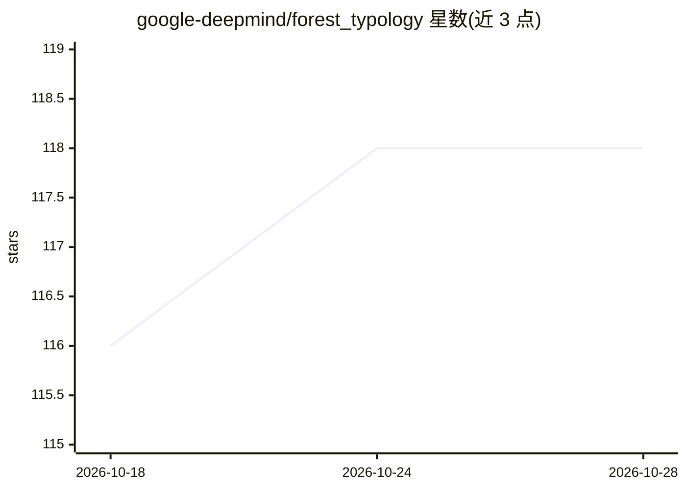

# google-deepmind/forest_typology

⭐ 118 · Jupyter Notebook · Apache-2.0 · 推送 2025-12-29 · [GitHub](https://github.com/google-deepmind/forest_typology) · 组织维护

**森林类型与栖息地制图的基准数据集与地图层集合**

Google DeepMind 联合世界资源研究所等伙伴发布的森林研究资源库：提供森林与栖息地地图层（如 2020 年全球天然林地图 v1、即将发布的全球森林损失驱动因素图层），以及面向 AI 研究者的基准数据集——ForTy v1 全球多时相多源森林类型分割基准，和用于人工林识别及树种/属识别子任务的大规模 Planted 数据集。未在 README 中给出安装或运行说明。

## 筛选速览

| 维度 | 判定 | 备注 |
|---|---|---|
| AI 角色 | `ai-knowledge` | 知识聚合/清单类 |
| 许可风险 | `permissive` | Apache-2.0 |
| 部署形态 | `None` |  |
| 模型依赖 | — | README 未给出锁定关系 |
| 硬件要求 | — | 无带数字的原话,不猜 |
| 安装摩擦 | `low` | 无编译、无系统依赖或容器化 |
| 成熟度 | — | 结构信号不足 |

## 能力要点

- ForTy v1：全球多时相多源的森林类型分割基准数据集
- Planted：人工林识别基准，含单一种植园树种与属识别子任务
- 2020 年全球天然林地图图层（v1），森林损失驱动因素图层即将发布

## 适用场景

- AI 研究者在森林类型分割任务上训练与评测模型
- 开展人工林识别与树种/属识别研究
- 获取全球天然林分布地图层用于生态分析

## 场景标签

`模型评测` · 领域:评测与运维

## 证据(README 行号)

> L14: global maps of forest land cover. In addition to releasing these layers we
> L25: * ForTy (v1) - global multi-temporal multi-source

## 星数曲线

2026-10-18 116 → 2026-10-28 118（+2）

---
*卡片 v1 · prompt 1.4 · 生成 2026-10-23 · 置信度 high · 依据 README sha `79ad6267fddb` · [字段定义](../../DATASET.md)*
