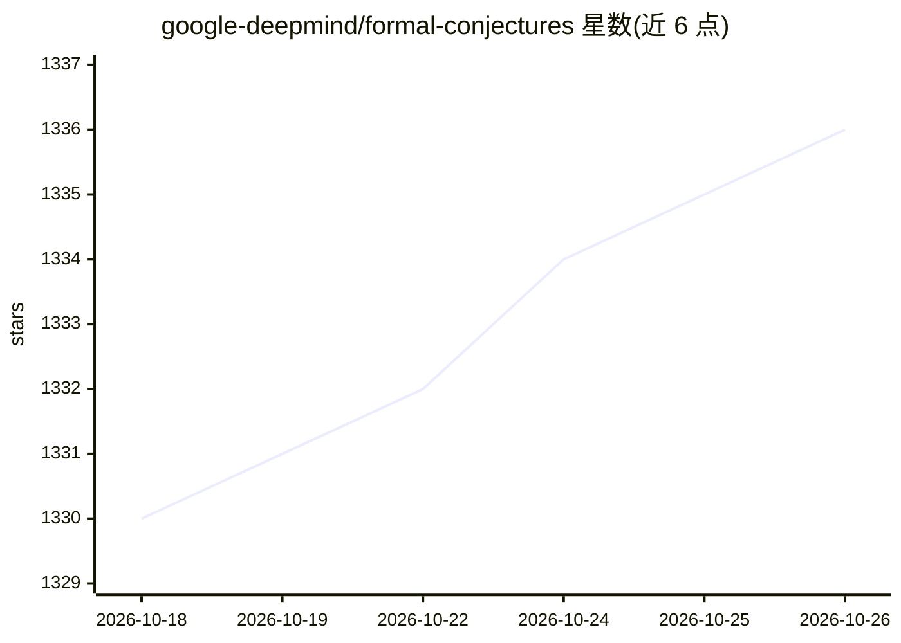

# google-deepmind/formal-conjectures

⭐ 1,336 · Lean · Apache-2.0 · 推送 2026-10-25 · [GitHub](https://github.com/google-deepmind/formal-conjectures) · [官网](https://google-deepmind.github.io/formal-conjectures/) · 组织维护

**面向 Lean 4/mathlib 的数学猜想形式化语句数据集**

由 DeepMind 维护的 Lean 4 猜想语句集合，依赖 mathlib，收录仅有形式化陈述而无证明的开放猜想，按猜想来源类型组织目录。目标是成为自动定理证明器与自动形式化工具的基准，并通过形式化澄清猜想的精确含义。以 lake 管理项目，安装 elan/lake/lean 后运行 lake exe cache get 与 lake build 构建；追踪 mathlib 月度发布，用不可变 tag（bench-v{N}-lean4.{X}.{Y}）发布稳定基准快照。计划借助 AlphaProof 辅助检查误形式化，并依赖人工审阅。

## 筛选速览

| 维度 | 判定 | 备注 |
|---|---|---|
| AI 角色 | `ai-knowledge` | 知识聚合/清单类 |
| 许可风险 | `permissive` | Apache-2.0 |
| 部署形态 | `None` |  |
| 模型依赖 | — | README 未给出锁定关系 |
| 硬件要求 | — | 无带数字的原话,不猜 |
| 安装摩擦 | `low` | 无编译、无系统依赖或容器化 |
| 成熟度 | — | 结构信号不足 |

## 能力要点

- Lean 4 + mathlib 形式化的猜想语句集合（不含证明）
- 作为自动定理证明器与自动形式化工具的基准，提供不可变 bench tag 快照
- 通过 @[category]/@[question] 等属性标注语句，目录按猜想来源组织
- 形式化准确性依赖人工审阅，并计划定期用 AlphaProof 检查潜在误形式化

## 适用场景

- 为自动定理证明或自动形式化工具提供评测基准
- 查阅猜想在 Lean 中的精确形式化表述
- 发现 mathlib 尚缺的定义以推动其扩展

## 场景标签

`模型评测` · 领域:评测与运维

## 证据(README 行号)

> L8: A collection of formalised statements of conjectures in
> L22: * Become a great benchmark for automated theorem provers and automated
> L27: It is our hope that this initiative will form the seed of a much richer dataset of

## 星数曲线

2026-10-18 1,330 → 2026-10-26 1,336（+6）

---
*卡片 v1 · prompt 1.4 · 生成 2026-10-21 · 置信度 high · 依据 README sha `d03f36922f70` · [字段定义](../../DATASET.md)*
