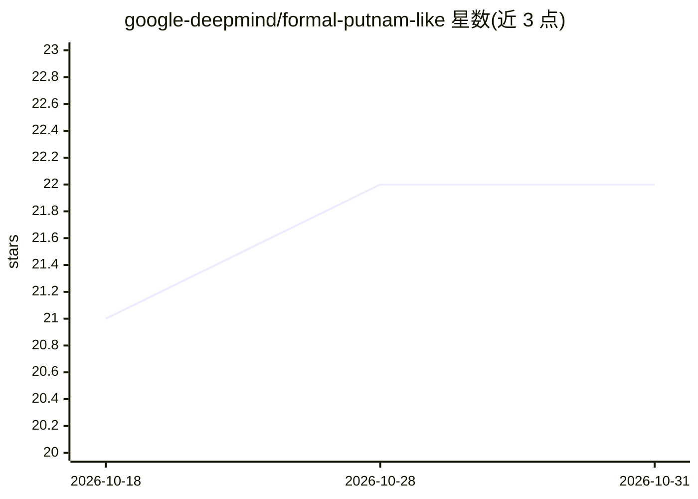

# google-deepmind/formal-putnam-like

⭐ 22 · Lean · Apache-2.0 · 推送 2026-08-28 · [GitHub](https://github.com/google-deepmind/formal-putnam-like) · 组织维护

**Putnam 类大学数学题的 Lean 形式化基准数据集**

由 Eric Wieser 与 Henryk Michalewski 维护的 Lean 形式化题库，收录 Putnam 竞赛风格的大学级数学问题，用于考察 AI 系统的数学推理深度。仓库本身提供 Lean 形式化代码；自然语言题面、评分细则、详细 README 及贡献专家信息在 eval_hub 仓库的 putnam_like 目录中。README 未给出安装运行命令。

## 筛选速览

| 维度 | 判定 | 备注 |
|---|---|---|
| AI 角色 | `ai-knowledge` | 知识聚合/清单类 |
| 许可风险 | `permissive` | Apache-2.0 |
| 部署形态 | `None` |  |
| 模型依赖 | — | README 未给出锁定关系 |
| 硬件要求 | — | 无带数字的原话,不猜 |
| 安装摩擦 | `low` | 无编译、无系统依赖或容器化 |
| 成熟度 | — | 结构信号不足 |

## 能力要点

- Putnam 风格大学级数学问题的 Lean 形式化集合
- 定位为考察 AI 数学推理的基准
- 自然语言题面与评分细则位于 eval_hub 关联仓库

## 适用场景

- 评估 AI 系统的数学推理能力
- 获取 Lean 形式化的高等数学问题用于研究
- 结合 eval_hub 的评分细则做基准测试

## 场景标签

`模型评测` · 领域:评测与运维

## 证据(README 行号)

> L3: This repository contains Lean formalizations of Putnam-like problems. This
> L6: Putnam-like is a benchmark crafted to probe the boundaries of mathematical

## 星数曲线

2026-10-18 21 → 2026-10-31 22（+1）

---
*卡片 v1 · prompt 1.4 · 生成 2026-10-28 · 置信度 high · 依据 README sha `8ca6f28576c2` · [字段定义](../../DATASET.md)*
