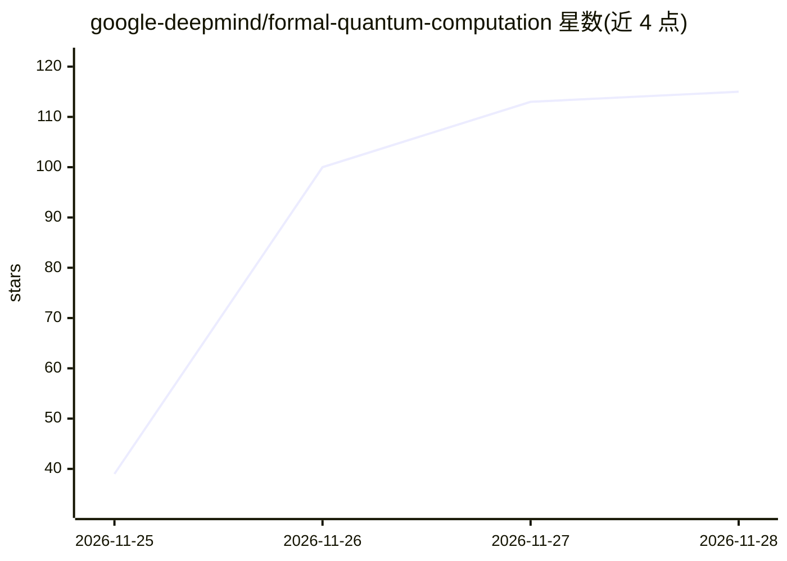

# google-deepmind/formal-quantum-computation

⭐ 115 · Lean · Apache-2.0 · 推送 2026-11-23 · [GitHub](https://github.com/google-deepmind/formal-quantum-computation) · 组织维护

**量子程序形式化规范与验证的 Lean 4 库**

基于量子 Hoare 逻辑（含经典变量）的 Lean 4 库，由两部分组成：核心库覆盖量子计算基础（线路、门、寄存器与底层数学）、量子 Hoare 逻辑形式化、资源计数框架及关键量子算法的验证；另一个库提供面向自动定理证明与 AI 辅助量子程序发现的规范与基准挑战。仓库还包含发现所得量子程序（discoveries 分支）。使用 lake 管理，需先安装 elan/lake/lean，依赖 Mathlib4 与 Physlib 的 QuantumInfo，版本钉在 tagged release。

## 筛选速览

| 维度 | 判定 | 备注 |
|---|---|---|
| AI 角色 | `ai-enhanced` | 去掉 AI 部分产品仍成立 |
| 许可风险 | `permissive` | Apache-2.0 |
| 部署形态 | `None` |  |
| 模型依赖 | — | README 未给出锁定关系 |
| 硬件要求 | — | 无带数字的原话,不猜 |
| 安装摩擦 | `low` | 无编译、无系统依赖或容器化 |
| 成熟度 | — | 结构信号不足 |

## 能力要点

- 量子 Hoare 逻辑（含经典变量）的形式化验证框架
- 覆盖量子线路、门、寄存器与底层数学基础
- 资源计数框架与关键量子算法验证
- 提供面向自动定理证明与 AI 辅助程序发现的规范基准

## 适用场景

- 对量子程序与量子算法做形式化验证
- 为自动定理证明工具提供量子程序规范基准
- 开展 AI 辅助量子程序发现的研究

## 场景标签

`科研工具` `模型评测` · 领域:评测与运维

## 证据(README 行号)

> L5: A Lean 4 library for formally specifying and verifying quantum programs, grounded in quantum Hoare logic with classi
> L11: * **`QuantumComputation`** is the core library covering the foundations of quantum computation (circuits, gates, re
> L12: * **`QuantumComputationSpecs`** is a separate library of specifications and benchmark challenges for automated theo
> L49: Copyright 2026 Google LLC

## 星数曲线

2026-11-25 39 → 2026-11-28 115（+76）

---
*卡片 v1 · prompt 1.4 · 生成 2026-11-24 · 置信度 high · 依据 README sha `f7c347a79755` · [字段定义](../../DATASET.md)*
