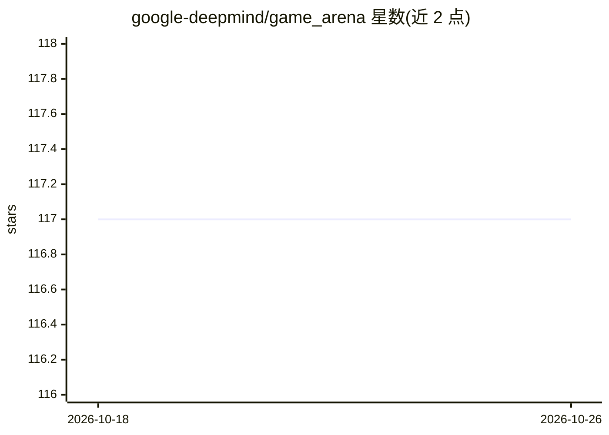

# google-deepmind/game_arena

⭐ 117 · Python · Apache-2.0 · 推送 2026-02-02 · [GitHub](https://github.com/google-deepmind/game_arena) · [官网](https://kaggle.com/game-arena) · 组织维护

**Google DeepMind 开发的 LLM 博弈对战评测框架**

Game Arena（Kaggle 平台）所用的 harness，开源于此仓库：编排游戏环境与模型调用、解析。基于 OpenSpiel 实现双人博弈状态跟踪与合法走子判定；提示层支持规范记法、棋盘视觉等多种表示；采样层提供多数投票（并行自一致）与 Rethinking（非法走子后重提示）两种策略；解析层含规则与 LLM 两类走子提取及软匹配；模型调用支持官方 SDK 与 HTTP POST，并带重试装饰器。面向研究/评测开发者。

## 筛选速览

| 维度 | 判定 | 备注 |
|---|---|---|
| AI 角色 | `ai-ecosystem` | LLM/agent 周边工具 |
| 许可风险 | `permissive` | Apache-2.0 |
| 部署形态 | `library` | 以包/库形式分发 |
| 模型依赖 | — | README 未给出锁定关系 |
| 硬件要求 | — | 无带数字的原话,不猜 |
| 安装摩擦 | `low` | 无编译、无系统依赖或容器化 |
| 成熟度 | — | 结构信号不足 |

## 能力要点

- 基于 OpenSpiel 的双人博弈环境与合法走子管理
- 多数投票与 Rethinking 两种应对非法走子的采样策略
- 规则式与 LLM 式两类走子解析，支持软匹配
- 官方 SDK 与 HTTP POST 两种模型调用方式，含 API 失败重试

## 适用场景

- 运行 LLM 之间的棋类等博弈对局
- 研究 LLM 在结构化博弈任务中的表现
- 复现或扩展 Game Arena 平台的评测流程

## 场景标签

`模型评测` · 领域:评测与运维

## 证据(README 行号)

> L3: This GitHub repository contains the harness developed by Google DeepMind for
> L5: other. The harness orchestrates the game environment with model calling and
> L138: Model calling is implemented with official SDKs in

## 星数曲线

2026-10-18 117 → 2026-10-26 117（+0）

---
*卡片 v1 · prompt 1.4 · 生成 2026-10-23 · 置信度 high · 依据 README sha `7d2adb48149a` · [字段定义](../../DATASET.md)*
