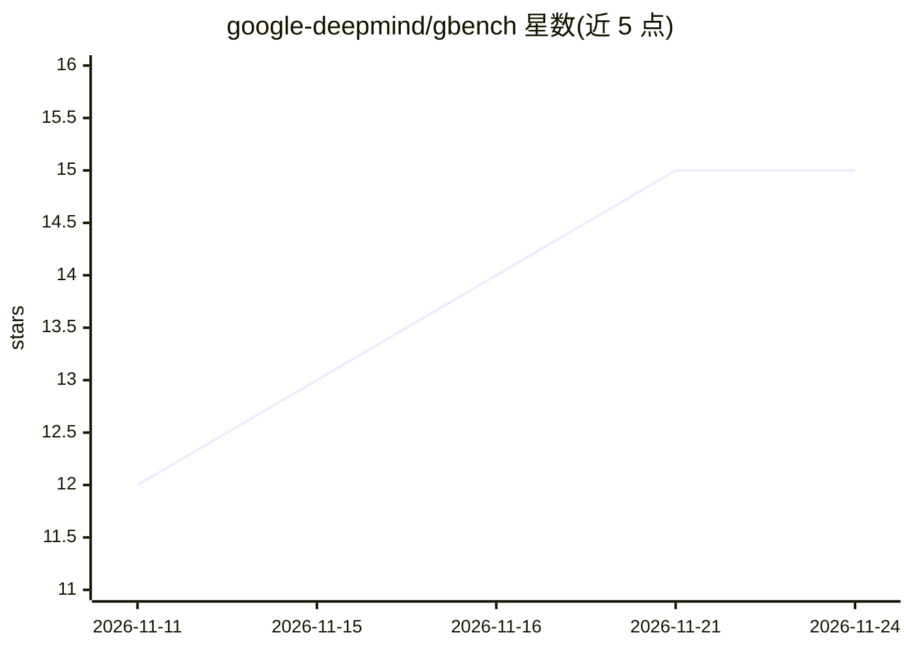

# google-deepmind/gbench

⭐ 105 · Python · Apache-2.0 · 推送 2026-11-16 · [GitHub](https://github.com/google-deepmind/gbench) · [官网](https://pypi.org/project/gbench/ ) · 组织维护

**开源 LLM/VLM 性能与能力评测基准套件**

面向开放权重大语言模型与视觉语言模型的评测与基准测试套件：测量所在硬件上的推理服务性能（延迟、并发、开环压测极限认证），并以三层能力评测——86 个学术/领域评测套件、16 项确定性 Golden Set 冒烟测试、GemmaClaw/OpenClaw 代理质量套件。支持任何 OpenAI 兼容 /v1 端点（在 vLLM 与 Ollama 上验证过），也可自行启动本地 vLLM 服务器；提供 GPU 分层建议、重复性与变异系数检查。以 Python 包从 PyPI 安装（Python 3.11+），代理质量套件需本地构建 Docker 镜像。

## 筛选速览

| 维度 | 判定 | 备注 |
|---|---|---|
| AI 角色 | `ai-ecosystem` | LLM/agent 周边工具 |
| 许可风险 | `permissive` | Apache-2.0 |
| 部署形态 | `self-host` | docker 或自建部署 |
| 模型依赖 | local-ok | 支持本地模型 |
| 硬件要求 | — | 无带数字的原话,不猜 |
| 安装摩擦 | `low` | 无编译、无系统依赖或容器化 |
| 成熟度 | — | 结构信号不足 |

## 能力要点

- OpenAI 兼容 /v1 端点测量（vLLM 与 Ollama 已验证），可自动启停本地 vLLM
- 三层能力评测：86 个学术套件（6 大支柱）、16 项 Golden Set 冒烟测试、GemmaClaw 代理质量套件
- 开环压测以 Poisson 调度逐级加倍速率，用 P99 SLO 探针认证吞吐极限（约 ±9% 分辨率）
- 按模型参数量给出 GPU 分层建议（20B/80B 分界）并校验 --num-gpus

## 适用场景

- 在自有硬件上测量开源模型的服务延迟与吞吐极限
- 运行学术评测套件对比开放模型的六类能力
- 用冒烟测试快速区分坏掉的 chat template 与弱模型

## 场景标签

`模型评测` · 领域:评测与运维

## 证据(README 行号)

> L5: gBench is an open-source benchmarking and evaluation suite for open large language models (LLMs) and vision-language
> L7: It works with any OpenAI-compatible `/v1` server through `--remote-endpoint` (validated on vLLM and Ollama; on Cloud
> L13: - OpenAI API compatibility: measure any OpenAI-compatible `/v1` endpoint with `--remote-endpoint <URL>/v1` (validat

## 星数曲线

2026-11-11 12 → 2026-11-24 15（+3）

---
*卡片 v1 · prompt 1.4 · 生成 2026-11-18 · 置信度 mid · 依据 README sha `5b99d4b5425d` · [字段定义](../../DATASET.md)*
