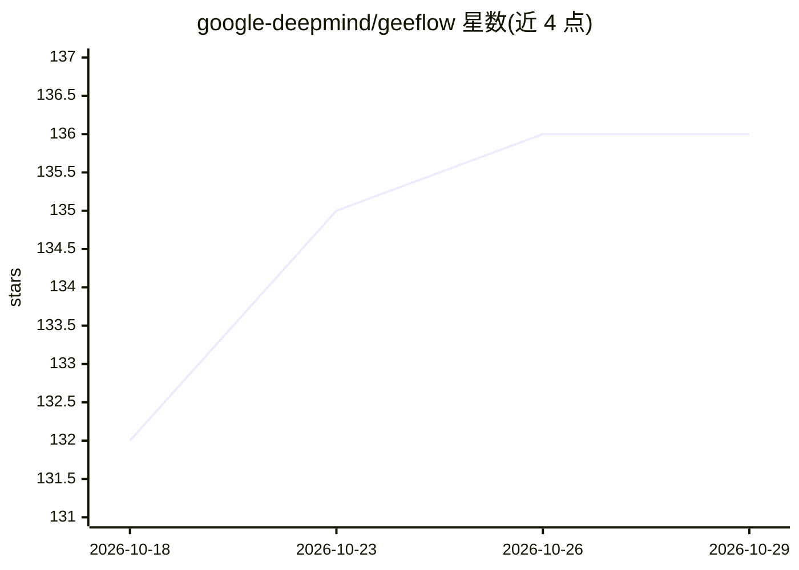

# google-deepmind/geeflow

⭐ 136 · Python · Apache-2.0 · 推送 2026-10-22 · [GitHub](https://github.com/google-deepmind/geeflow) · [官网](https://google-deepmind.github.io/geeflow/) · 组织维护

**面向地理空间 AI 研究的大规模数据集生成库（基于 Google Earth Engine）**

GeeFlow 是 Python 库，使用 Google Earth Engine 读取卫星与遥感数据源，按 CSV/parquet 位置文件和 ML Collections 配置生成 TFDS 格式的监督/无监督数据集，可用于地理空间 AI 模型训练，并支持生成任意分辨率乃至全球尺度的推理图。数据生成通过 Apache Beam 管道执行，含按波段的统计计算、语义化版本与数据记录机制。README 明确其不涵盖模型训练、GEE 交互式可视化与数据集仓库，且非生产级工具。使用需 GEE/GCP 账号认证，从源码 clone 后 pip install -e . 安装。

## 筛选速览

| 维度 | 判定 | 备注 |
|---|---|---|
| AI 角色 | `ai-ecosystem` | LLM/agent 周边工具 |
| 许可风险 | `permissive` | Apache-2.0 |
| 部署形态 | `library` | 以包/库形式分发 |
| 模型依赖 | — | README 未给出锁定关系 |
| 硬件要求 | — | 无带数字的原话,不猜 |
| 安装摩擦 | `low` | 无编译、无系统依赖或容器化 |
| 成熟度 | — | 结构信号不足 |

## 能力要点

- 从 GEE 读取任意卫星/遥感数据与标签数据，生成 TFDS 格式数据集
- 支持任意时空分辨率、多源多波段配置与训练集按地理分块划分
- 生成可达全球尺度的推理图
- 基于 Apache Beam 的数据生成与各波段统计计算管道

## 适用场景

- 为地理空间 AI 模型训练准备大规模卫星影像数据集
- 按自定义时空分辨率与波段组合采样遥感数据
- 生成从区域到全球尺度的模型推理图

## 场景标签

 · 领域:地球观测/地理空间 AI

## 证据(README 行号)

> L6: is on supporting geospatial AI research, and it does not aim to be a
> L14: - Creating small- and large-scale datasets, supervised and unsupervised, ready
> L25: - Model training and inference. Pick your favorite framework, e.g. for

## 星数曲线

2026-10-18 132 → 2026-10-29 136（+4）

---
*卡片 v1 · prompt 1.4 · 生成 2026-10-22 · 置信度 mid · 依据 README sha `64cd8389316e` · [字段定义](../../DATASET.md)*
