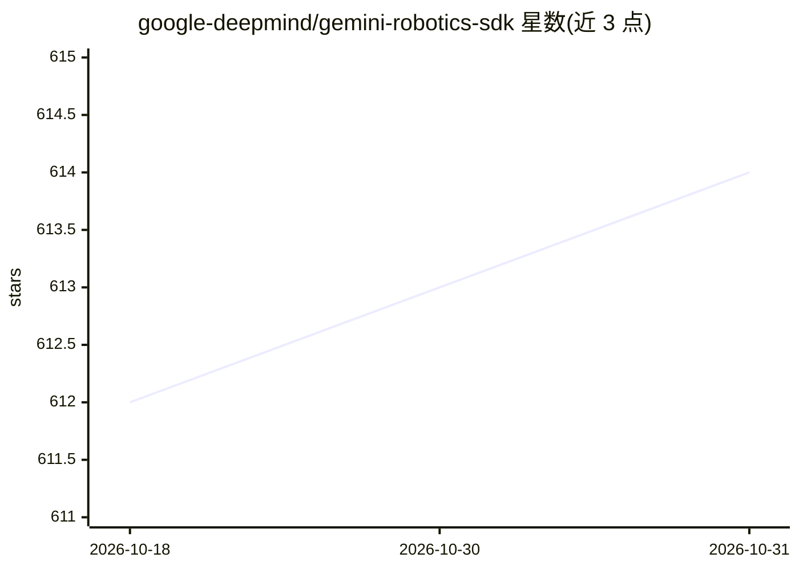

# google-deepmind/gemini-robotics-sdk

⭐ 614 · Python · Apache-2.0 · 推送 2026-10-12 · [GitHub](https://github.com/google-deepmind/gemini-robotics-sdk) · 组织维护

**Gemini Robotics 模型全生命周期 SDK：访问/服务/评测/微调**

Google DeepMind 发布的 Python SDK，为 Gemini Robotics 系列模型提供访问 checkpoint、启动模型服务、在真机与仿真中评测、上传数据、发起微调并下载结果的全生命周期工具。包含 flywheel CLI（train/serve/download 等命令）与面向交互式机器人 agent 的框架（Agents/Embodiments/Tools/Event Bus 组件），并附带 Aloha 机器人示例。以单一 pip 包分发（含编译的 C++ 日志扩展）；多数功能需加入 Gemini Robotics Trusted Tester Program。README 声明非官方支持的 Google 产品，代码仍在活跃开发中。

## 筛选速览

| 维度 | 判定 | 备注 |
|---|---|---|
| AI 角色 | `ai-ecosystem` | LLM/agent 周边工具 |
| 许可风险 | `permissive` | Apache-2.0 |
| 部署形态 | `library` | 以包/库形式分发 |
| 模型依赖 | — | README 未给出锁定关系 |
| 硬件要求 | — | 无带数字的原话,不猜 |
| 安装摩擦 | `low` | 无编译、无系统依赖或容器化 |
| 成熟度 | `idea` | |

## 能力要点

- 覆盖 checkpoint 访问、模型服务、真机/仿真评测、数据上传与微调请求的全生命周期工具
- flywheel CLI 提供 train/serve/list/download/upload_data 等命令
- 模块化 agent 框架：Agents（接入 Gemini Live API）、Embodiments（如 Aloha 硬件接口）、Tools、Event Bus
- Aloha 示例：自然语言对话控制机器人，含视觉控制与多相机感知

## 适用场景

- 作为 Trusted Tester 使用 Gemini Robotics On Device 模型开发机器人应用
- 通过 CLI 发起模型微调、部署服务并下载训练产物
- 基于 agent 框架构建对话式机器人控制 agent（如 Aloha 平台）

## 场景标签

`Agent 框架` `模型评测` `微调` `推理引擎` · 领域:Agent 开发

## 证据(README 行号)

> L7: Safari SDK provides full lifecycle toolings necessary for using Gemini Robotics
> L8: models, including but not limited to, access checkpoint, serving a model,
> L9: evaluate the model on robot and in sim, upload data, finetuning the model,
> L130: The Safari SDK includes a comprehensive agent framework for building interactive

## 星数曲线

2026-10-18 612 → 2026-10-31 614（+2）

---
*卡片 v1 · prompt 1.4 · 生成 2026-10-21 · 置信度 high · 依据 README sha `2a68ac51cbc1` · [字段定义](../../DATASET.md)*
