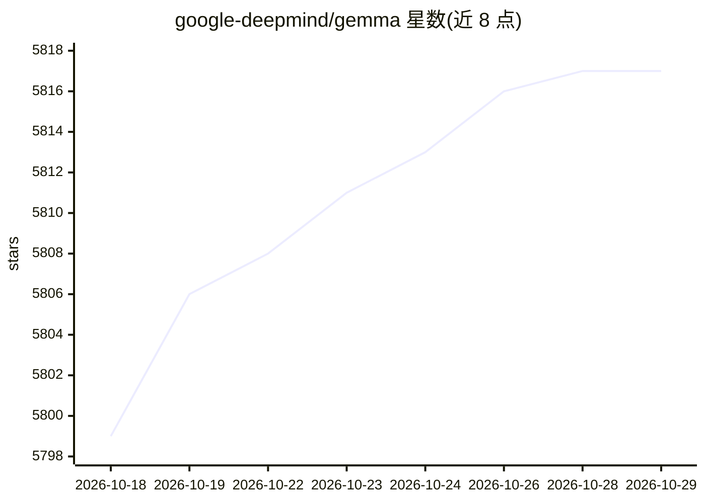

# google-deepmind/gemma

⭐ 5,817 · Python · Apache-2.0 · 推送 2026-10-28 · [GitHub](https://github.com/google-deepmind/gemma) · [官网](https://gemma-llm.readthedocs.io) · 组织维护

**Google DeepMind 的 Gemma 开放权重 LLM 的 JAX 使用与微调库**

提供 `gemma` PyPI 包：基于 JAX 的库，用于运行、采样和微调 Google DeepMind 的 Gemma 系列开放权重 LLM（基于 Gemini 研究与技术）。支持多轮多模态对话的 ChatSampler API，兼容 Gemma 2/3/3n/4 各版本；文档含采样、多模态、微调、LoRA 等 Colab 教程，examples/ 目录附微调与采样脚本。需先安装 JAX（CPU/GPU/TPU），模型权重另行下载；GPU 建议 2B 检查点 8GB+ 显存、7B 检查点 24GB+ 显存。

## 筛选速览

| 维度 | 判定 | 备注 |
|---|---|---|
| AI 角色 | `ai-native` | 本体是模型或模型工具 |
| 许可风险 | `permissive` | Apache-2.0 |
| 部署形态 | `library` | 以包/库形式分发 |
| 模型依赖 | — | README 未给出锁定关系 |
| 硬件要求 | — | 无带数字的原话,不猜 |
| 安装摩擦 | `low` | 无编译、无系统依赖或容器化 |
| 成熟度 | — | 结构信号不足 |

## 能力要点

- ChatSampler API 支持多轮多模态对话，兼容 Gemma 2/3/3n/4
- 支持微调与 LoRA，附 Colab 教程与示例脚本
- 可在 CPU、GPU 和 TPU 上运行

## 适用场景

- 用 JAX 加载 Gemma 模型进行对话与采样
- 对 Gemma 检查点做微调或 LoRA 微调
- 在 GPU/TPU 上运行开放权重 LLM 做研究

## 场景标签

`微调` `教程课程` · 领域:学习与行业

## 证据(README 行号)

> L7: Gemma is a family of open-weights Large Language
> L13: JAX library to use and fine-tune Gemma.

## 星数曲线

2026-10-18 5,799 → 2026-10-29 5,817（+18）

---
*卡片 v1 · prompt 1.4 · 生成 2026-10-20 · 置信度 high · 依据 README sha `bcd5c36be2a8` · [字段定义](../../DATASET.md)*
