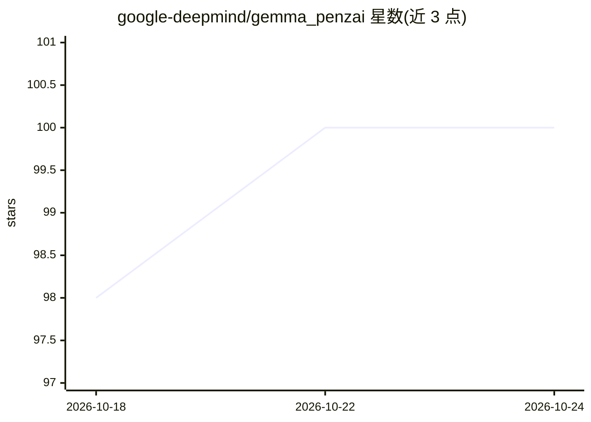

# google-deepmind/gemma_penzai

⭐ 100 · Jupyter Notebook · Apache-2.0 · 推送 2026-01-13 · [GitHub](https://github.com/google-deepmind/gemma_penzai) · 组织维护

**基于 Penzai 的 Gemma 模型可视化与研究工具包**

Google DeepMind 维护的 JAX 研究工具包，基于 Penzai 扩展对 Gemma 3 的支持，新增 Vision Transformers 组件、含视觉编码器与 LLM 骨干的多模态模型实现（含新注意力掩码）及多模态解码算法，用于可视化、操纵和理解模型内部机制。面向可解释性研究人员，提供 notebooks 教程（含 attention sink、logit-lens、Gemma Scope 1/2），通过 git clone 后 pip install -e . 安装。

## 筛选速览

| 维度 | 判定 | 备注 |
|---|---|---|
| AI 角色 | `ai-ecosystem` | LLM/agent 周边工具 |
| 许可风险 | `permissive` | Apache-2.0 |
| 部署形态 | `library` | 以包/库形式分发 |
| 模型依赖 | — | README 未给出锁定关系 |
| 硬件要求 | — | 无带数字的原话,不猜 |
| 安装摩擦 | `low` | 无编译、无系统依赖或容器化 |
| 成熟度 | — | 结构信号不足 |

## 能力要点

- 扩展 Penzai 支持 Gemma 3 的视觉与多模态模型
- 提供 ViT 组件、MLLM 实现与多模态解码算法
- notebooks 含 attention sink、logit-lens、Gemma Scope 教程

## 适用场景

- 对 Gemma 3 多模态模型做可解释性研究
- 可视化与编辑 Gemma 模型内部结构
- 复现 Gemma Scope 等机制解释实验

## 场景标签

`科研工具` · 领域:学习与行业

## 证据(README 行号)

> L3: `gemma_penzai` is JAX research toolkit for visualizing, manipulating and
> L22: internal mechanism of Gemma. Therefore, we extend the implementation of Gemma

## 星数曲线

2026-10-18 98 → 2026-10-24 100（+2）

---
*卡片 v1 · prompt 1.4 · 生成 2026-10-23 · 置信度 mid · 依据 README sha `3e869c305ace` · [字段定义](../../DATASET.md)*
