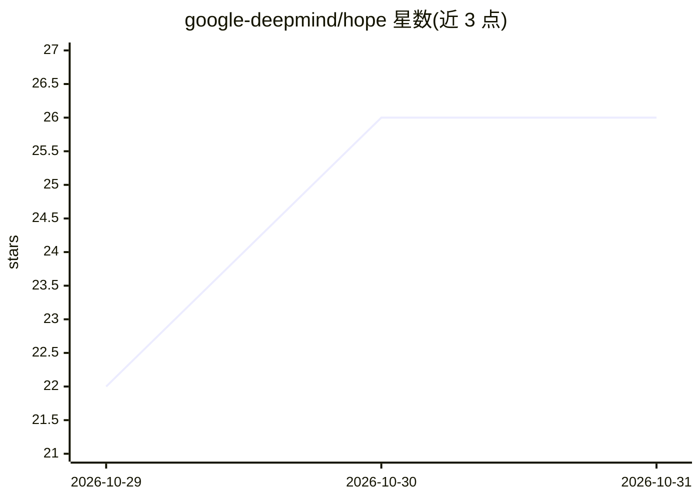

# google-deepmind/hope

⭐ 26 · Python · Apache-2.0 · 推送 2026-10-27 · [GitHub](https://github.com/google-deepmind/hope) · [官网](https://arxiv.org/abs/2607.21366) · 组织维护

**深度网络数据免依赖渐进压缩与迁移微调的参考实现（HOPE/DEFT）**

DeepMind 发布的研究参考实现，含两部分：HOPE 将 ImageNet 预训练的 Keras ResNet-50 通过 PRUNE/MERGE/EVICT 三种解析动作按率失真准则贪心压缩为可逐步解码的课程，全程数据无关（仅用权重与 BatchNorm 统计量闭式计算，无需训练图像或校准数据），可无损恢复原始网络；DEFT 利用 HOPE 课程将隐层划分为冻结 Universal Core 与可塑 Slack，在目标微调中保证源任务零遗忘，附 CIFAR-100→SVHN 基准。核心库仅依赖 NumPy/SciPy（要求 NumPy≥2.0），运行器另需 Keras 3/TensorFlow，DEFT 用 JAX/Optax，附 arXiv 论文。

## 筛选速览

| 维度 | 判定 | 备注 |
|---|---|---|
| AI 角色 | `ai-native` | 本体是模型或模型工具 |
| 许可风险 | `permissive` | Apache-2.0 |
| 部署形态 | `library` | 以包/库形式分发 |
| 模型依赖 | — | README 未给出锁定关系 |
| 硬件要求 | — | 无带数字的原话,不猜 |
| 安装摩擦 | `low` | 无编译、无系统依赖或容器化 |
| 成熟度 | — | 结构信号不足 |

## 能力要点

- PRUNE/MERGE/EVICT 三动作按率失真贪心选择，课程可解码至任意中间密度
- 严格数据无关：仅凭权重与 BN 统计量闭式评估，无需训练/校准数据
- DEFT 将隐层划分为冻结 Core 与可塑 Slack，保证源任务零动态遗忘
- 附带七个数据无关结构化压缩基线与自检测试脚本

## 适用场景

- 在任意密度点获得压缩后的 ResNet-50 并验证无损解码
- 复现论文中的压缩曲线与跨域迁移基准
- 比较 HOPE 与七个结构化压缩基线的密度-精度表现

## 场景标签

`微调` `模型量化` · 领域:训练与推理

## 证据(README 行号)

> L7: 1. **Data-Free Progressive Model Compression (`hope.py`, `compress_resnet50.py`,
> L24: 2. **Cross-Domain Transfer Learning via Dispersed Elastic Fine-Tuning

## 星数曲线

2026-10-29 22 → 2026-10-31 26（+4）

---
*卡片 v1 · prompt 1.4 · 生成 2026-10-28 · 置信度 mid · 依据 README sha `45b76ae37d2e` · [字段定义](../../DATASET.md)*
