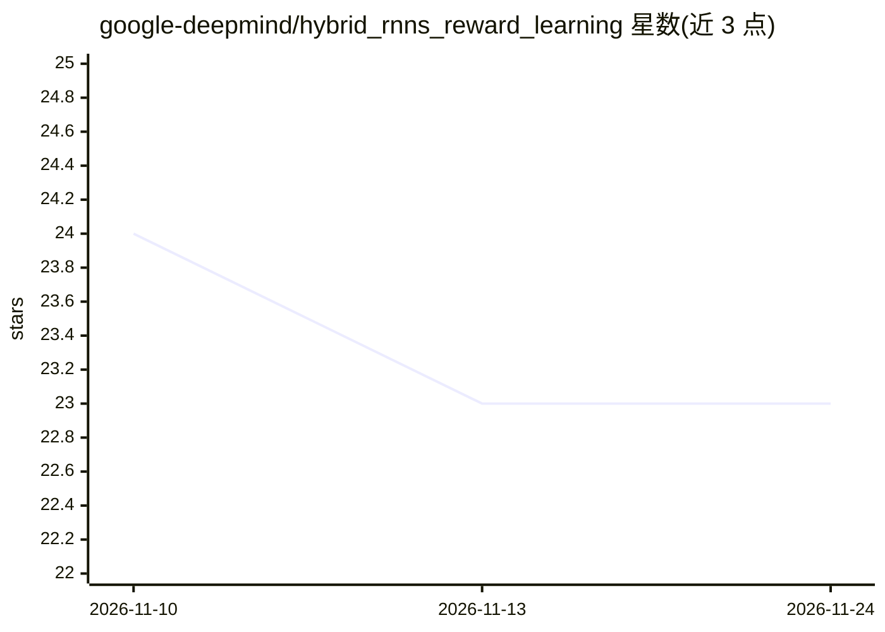

# google-deepmind/hybrid_rnns_reward_learning

⭐ 23 · Jupyter Notebook · Apache-2.0 · 推送 2026-11-10 · [GitHub](https://github.com/google-deepmind/hybrid_rnns_reward_learning) · 组织维护

**用混合 RNN 拟合人类行为数据的科研代码库**

DeepMind 发布的科研代码：将'混合 RNN'（结合循环网络与认知模型参数）拟合到行为数据集（通常为人类被试的 bandit 任务）。用户通过 config 指定训练步数、批大小、隐藏层规模及认知模型参数（学习率、遗忘、决策温度、循环类型等），调用 fit_hyb_rnn.train 运行训练；提供 Colab notebook 与示例数据集。全量数据训练单模型在 2024 年 Colab 标准资源下需数小时，论文发表于 psyarxiv。

## 筛选速览

| 维度 | 判定 | 备注 |
|---|---|---|
| AI 角色 | `ai-native` | 本体是模型或模型工具 |
| 许可风险 | `permissive` | Apache-2.0 |
| 部署形态 | `library` | 以包/库形式分发 |
| 模型依赖 | — | README 未给出锁定关系 |
| 硬件要求 | — | 无带数字的原话,不猜 |
| 安装摩擦 | `low` | 无编译、无系统依赖或容器化 |
| 成熟度 | — | 结构信号不足 |

## 能力要点

- 拟合混合 RNN（神经-认知混合模型）到人类行为数据
- config 可配置认知模型参数与循环类型（context vs memory）
- 提供 Colab notebook（train_models.ipynb）与示例数据集
- 对应论文：Hybrid Neural-Cognitive Models Reveal How Memory Shapes Human Reward Learning

## 适用场景

- 科研人员用行为数据拟合混合 RNN 分析人类奖励学习机制
- 通过 Colab 交互式运行模型训练 demo
- 对比不同循环类型与认知参数对拟合结果的影响

## 场景标签

`科研工具` · 领域:学习与行业

## 证据(README 行号)

> L3: This code fits "hybrid RNNs" to behavioral datasets. Behavioral datasets will
> L4: usually be bandit tasks performed by humans.

## 星数曲线

2026-11-10 24 → 2026-11-24 23（-1）

---
*卡片 v1 · prompt 1.4 · 生成 2026-11-18 · 置信度 mid · 依据 README sha `8c7e4820345b` · [字段定义](../../DATASET.md)*
