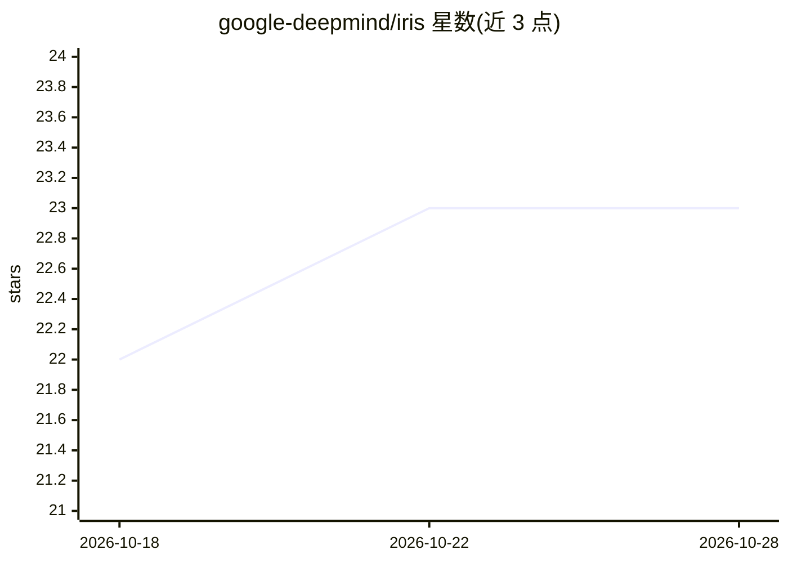

# google-deepmind/iris

⭐ 23 · Python · Apache-2.0 · 推送 2026-10-26 · [GitHub](https://github.com/google-deepmind/iris) · 组织维护

**分布式黑盒优化库：大规模进化方法训练神经网络**

Google DeepMind 开源的同步分布式零阶（黑盒）优化库，主要用于以进化方法训练大型神经网络，也可优化任意高维黑盒函数。提供 pip 安装，通过 python3 -m iris.launch 启动本地（多进程）优化。README 关联十余篇机器人与强化学习论文（乒乓球机器人、四足运动、SARA-RT 等）。声明非 Google 官方支持产品。

## 筛选速览

| 维度 | 判定 | 备注 |
|---|---|---|
| AI 角色 | `ai-native` | 本体是模型或模型工具 |
| 许可风险 | `permissive` | Apache-2.0 |
| 部署形态 | `library` | 以包/库形式分发 |
| 模型依赖 | — | README 未给出锁定关系 |
| 硬件要求 | — | 无带数字的原话,不猜 |
| 安装摩擦 | `low` | 无编译、无系统依赖或容器化 |
| 成熟度 | — | 结构信号不足 |

## 能力要点

- 同步分布式零阶（黑盒）优化
- 面向用进化方法训练大型神经网络
- 可用于任意高维黑盒函数优化

## 适用场景

- 用进化策略在多机上训练神经网络策略
- 优化无梯度可得的高维目标函数
- 机器人控制策略的分布式训练

## 场景标签

 · 领域:机器学习库/优化

## 证据(README 行号)

> L7: Iris is a library for performing synchronous and distributed zeroth-order
> L8: optimization at scale. It is meant primarily to train large neural networks with

## 星数曲线

2026-10-18 22 → 2026-10-28 23（+1）

---
*卡片 v1 · prompt 1.4 · 生成 2026-10-27 · 置信度 high · 依据 README sha `17f59dc88046` · [字段定义](../../DATASET.md)*
