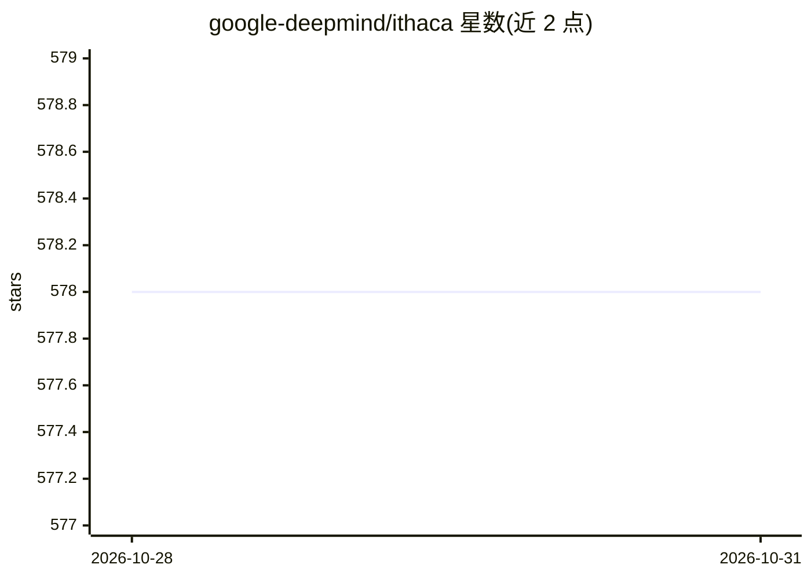

# google-deepmind/ithaca

⭐ 578 · Jupyter Notebook · Apache-2.0 · 推送 2026-10-27 · [GitHub](https://github.com/google-deepmind/ithaca) · 组织维护

**深度神经网络修复与溯源古希腊铭文的模型库**

DeepMind 与多所大学合作发布的深度神经网络 Ithaca 及其训练产物，用于古希腊铭文的文本修复、地理归属与年代判定（定年误差小于 30 年），面向古文字学/古代史研究者，定位为协作式决策支持工具。以 Python 库 ithaca 提供：pip 安装后下载预训练 checkpoint，通过 inference_example.py 对输入文本运行修复与归属推断，输出 JSON 结果；另提供 Colab 交互界面可视化注意力权重，训练数据基于 PHI 希腊铭文数据集（I.PHI），训练说明见 train/README.md，采用 Apache 2.0 许可。

## 筛选速览

| 维度 | 判定 | 备注 |
|---|---|---|
| AI 角色 | `ai-native` | 本体是模型或模型工具 |
| 许可风险 | `permissive` | Apache-2.0 |
| 部署形态 | `library` | 以包/库形式分发 |
| 模型依赖 | — | README 未给出锁定关系 |
| 硬件要求 | — | 无带数字的原话,不猜 |
| 安装摩擦 | `low` | 无编译、无系统依赖或容器化 |
| 成熟度 | — | 结构信号不足 |

## 能力要点

- 对古希腊铭文做文本修复、地理归属与年代判定
- 提供预训练模型 checkpoint，本地离线推断输出 JSON
- Colab 交互界面可查询修复结果并可视化注意力权重
- 基于 PHI 数据集，训练流程独立文档说明

## 适用场景

- 我研究古希腊铭文，想让模型辅助补全残损文字
- 我想为铭文推断原始书写地点与年代区间
- 我想用预训练模型在自己的数据上离线跑推断

## 场景标签

`科研工具` · 领域:学习与行业

## 证据(README 行号)

> L21: present Ithaca, the first Deep Neural Network for the textual restoration,
> L29: While Ithaca alone achieves 62% accuracy when restoring damaged texts, as soon
> L80: python inference_example.py --input_file=example_input.txt

## 星数曲线

2026-10-28 578 → 2026-10-31 578（+0）

---
*卡片 v1 · prompt 1.4 · 生成 2026-10-28 · 置信度 high · 依据 README sha `9c1cb8f7a2fc` · [字段定义](../../DATASET.md)*
