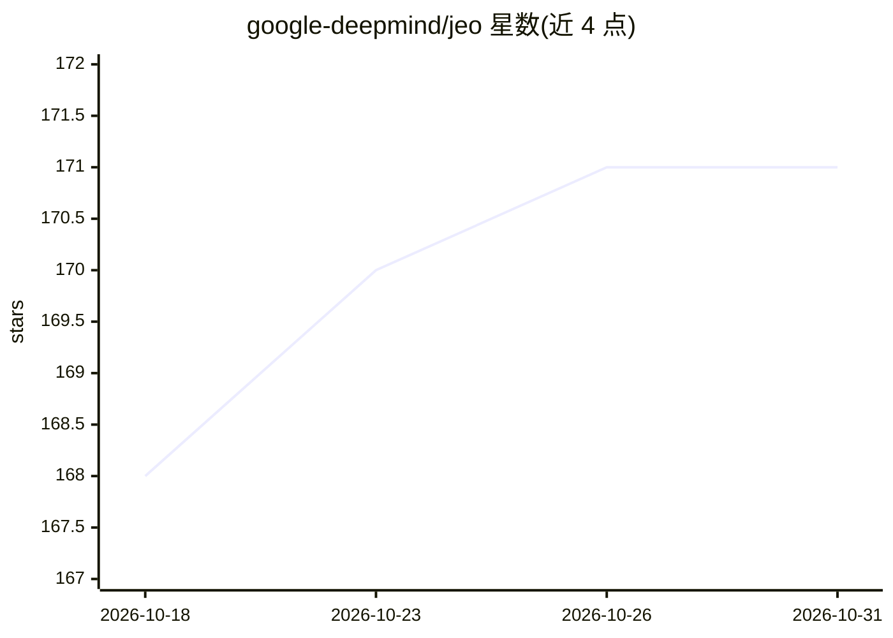

# google-deepmind/jeo

⭐ 171 · Python · Apache-2.0 · 推送 2026-10-22 · [GitHub](https://github.com/google-deepmind/jeo) · [官网](https://google-deepmind.github.io/jeo/) · 组织维护

**JAX 地球观测/遥感模型训练与推理框架**

Google DeepMind 开源的基于 JAX/Flax 的地理空间遥感与地球观测模型训练框架，用 tf.data 与 TensorFlow Datasets 构建数据管道（也支持其他加载器），可在 CPU、GPU 和 Google Cloud TPU VM 上运行，并与 GeeFlow/Google Earth Engine 集成构建大规模地理空间数据集。代码库服务于森林砍伐归因、人工林识别、森林类型基准、分割不确定性评估、砍伐风险预测等多项已发表论文项目。安装方式为 git clone 源码并在虚拟环境中装依赖。

## 筛选速览

| 维度 | 判定 | 备注 |
|---|---|---|
| AI 角色 | `ai-native` | 本体是模型或模型工具 |
| 许可风险 | `permissive` | Apache-2.0 |
| 部署形态 | `None` |  |
| 模型依赖 | — | README 未给出锁定关系 |
| 硬件要求 | — | 无带数字的原话,不猜 |
| 安装摩擦 | `low` | 无编译、无系统依赖或容器化 |
| 成熟度 | — | 结构信号不足 |

## 能力要点

- 基于 JAX/Flax 的地理空间模型训练与推理框架
- tf.data + TensorFlow Datasets 数据管道，支持其他加载器
- 支持 CPU/GPU/TPU VM 运行
- 与 Google Earth Engine（GeeFlow）集成构建大规模数据集

## 适用场景

- 训练遥感影像的分类/分割深度学习模型
- 复现或扩展地球观测相关研究（森林监测、砍伐归因等）
- 在 TPU/GPU 上运行地球观测模型的训练与评估

## 场景标签

`模型训练` `推理引擎` · 领域:训练与推理

## 证据(README 行号)

> L8: Jeo provides a framework for training machine learning models for geospatial
> L9: remote sensing and Earth Observation using JAX

## 星数曲线

2026-10-18 168 → 2026-10-31 171（+3）

---
*卡片 v1 · prompt 1.4 · 生成 2026-10-22 · 置信度 high · 依据 README sha `5a58a573dc42` · [字段定义](../../DATASET.md)*
