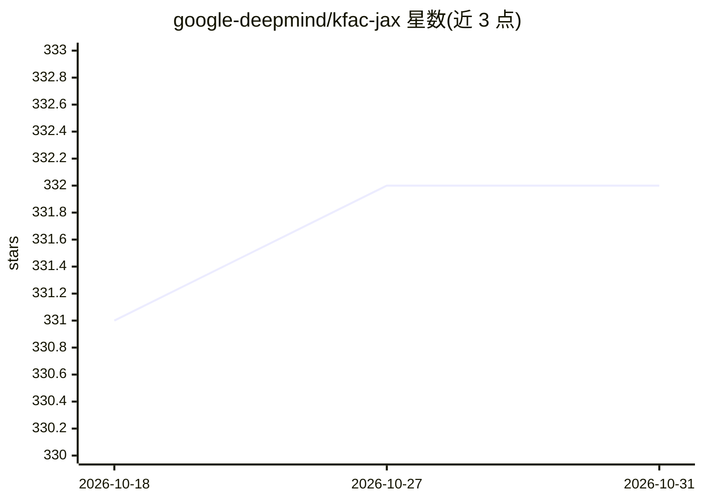

# google-deepmind/kfac-jax

⭐ 332 · Python · Apache-2.0 · 推送 2026-10-13 · [GitHub](https://github.com/google-deepmind/kfac-jax) · 组织维护

**面向研究者的 JAX 二阶优化与曲率估计库（K-FAC）**

基于 JAX 的神经网络二阶优化库，提供 K-FAC 优化器与可扩展曲率近似计算，供研究人员训练神经网络使用。机制上要求用户注册模型精确损失函数（如 register_softmax_cross_entropy_loss），优化器内部自动 jit/pmap 分期，损失须按 minibatch 平均。纯 Python 编写，经 JAX 依赖 C++ 代码；通过 pip（git 或 PyPI）安装，示例需额外 extras。

## 筛选速览

| 维度 | 判定 | 备注 |
|---|---|---|
| AI 角色 | `ai-ecosystem` | LLM/agent 周边工具 |
| 许可风险 | `permissive` | Apache-2.0 |
| 部署形态 | `library` | 以包/库形式分发 |
| 模型依赖 | — | README 未给出锁定关系 |
| 硬件要求 | — | 无带数字的原话,不猜 |
| 安装摩擦 | `low` | 无编译、无系统依赖或容器化 |
| 成熟度 | — | 结构信号不足 |

## 能力要点

- K-FAC 优化器与可扩展曲率近似实现
- 自动注册系统识别模型参数与损失结构
- 内部自动 jit/pmap，通过 multi_device 标志控制分期行为
- 支持辅助输出、函数状态与 PRNG key 的损失函数签名

## 适用场景

- 在 JAX/Haiku 中用 K-FAC 二阶方法训练神经网络
- 研究神经网络的曲率近似与二阶优化
- 替换一阶优化器进行训练实验对比

## 场景标签

`模型训练` · 领域:训练与推理

## 证据(README 行号)

> L13: KFAC-JAX is a library built on top of [JAX] for second-order optimization of
> L16: implementation of the [K-FAC] optimizer and curvature estimator.

## 星数曲线

2026-10-18 331 → 2026-10-31 332（+1）

---
*卡片 v1 · prompt 1.4 · 生成 2026-10-21 · 置信度 high · 依据 README sha `98ca7430f77c` · [字段定义](../../DATASET.md)*
