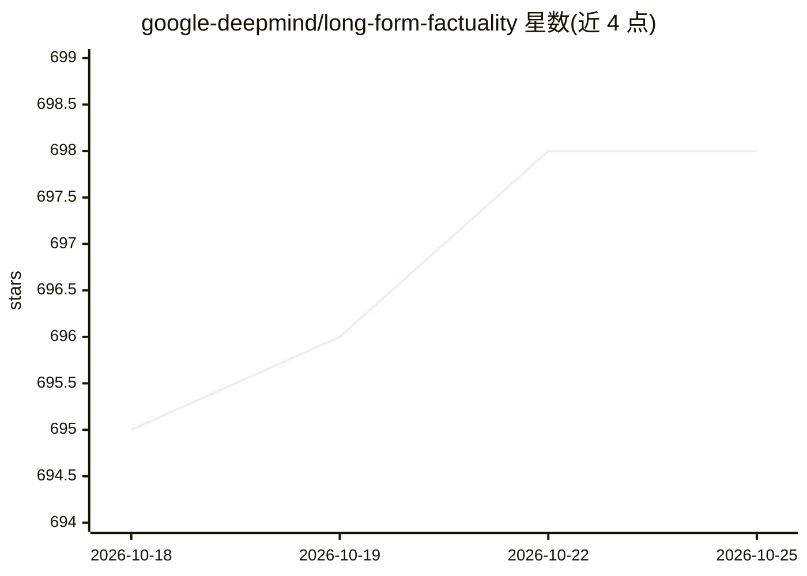

# google-deepmind/long-form-factuality

⭐ 698 · Python · NOASSERTION · 推送 2026-06-18 · [GitHub](https://github.com/google-deepmind/long-form-factuality) · [官网](https://arxiv.org/abs/2403.18802) · 组织维护

**LLM 长文本事实性基准：LongFact 提示集与 SAFE 评估器**

Google DeepMind 论文 Long-form factuality in large language models 的官方代码发布，包含四部分：LongFact（2,280 条需要长回答的事实性提示集）、搜索增强事实性评估器 SAFE、面向长文本的 F1@K 指标，以及用 LongFact + SAFE 对 OpenAI 与 Anthropic 模型做基准测试的实验流水线。安装方式为 git clone 源码、conda 建 Python 3.10+ 环境并 pip 安装依赖；评测模型需在配置文件中填入 API key，附单元测试。

## 筛选速览

| 维度 | 判定 | 备注 |
|---|---|---|
| AI 角色 | `ai-ecosystem` | LLM/agent 周边工具 |
| 许可风险 | `none` | NOASSERTION |
| 部署形态 | `library` | 以包/库形式分发 |
| 模型依赖 | — | README 未给出锁定关系 |
| 硬件要求 | — | 无带数字的原话,不猜 |
| 安装摩擦 | `low` | 无编译、无系统依赖或容器化 |
| 成熟度 | — | 结构信号不足 |

## 能力要点

- LongFact：2,280 条长文本事实性提示数据集
- SAFE：基于搜索增强的自动事实性评估器
- F1@K：将 F1 指标扩展到长文本场景
- 支持对 OpenAI 与 Anthropic 模型跑完整评测流水线

## 适用场景

- 评测 LLM 长回答中的事实性表现
- 复现论文中的 LongFact + SAFE 基准实验
- 用 SAFE 对照 FActScore 人工标注做相关性验证

## 场景标签

`模型评测` · 领域:评测与运维

## 证据(README 行号)

> L6: 1. **LongFact**: A prompt set of 2,280 fact-seeking prompts requiring long-form responses.
> L7: 2. **Search-Augmented Factuality Evaluator (SAFE)**: Automatic evaluation of model responses in long-form factuality

## 星数曲线

2026-10-18 695 → 2026-10-25 698（+3）

---
*卡片 v1 · prompt 1.4 · 生成 2026-10-21 · 置信度 mid · 依据 README sha `ffc393c6bf43` · [字段定义](../../DATASET.md)*
