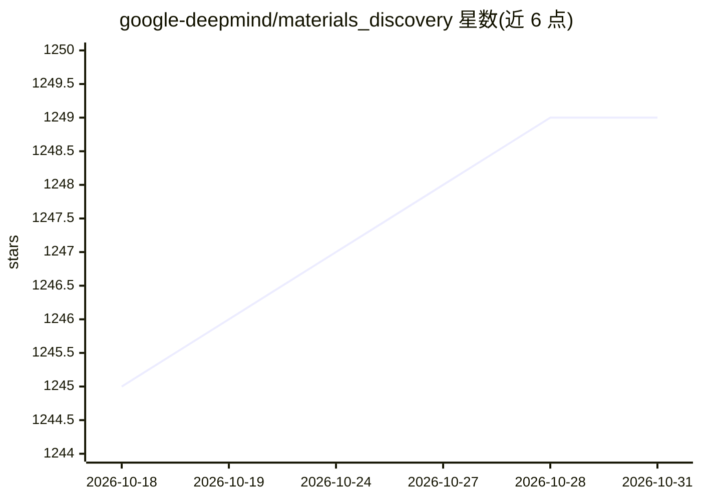

# google-deepmind/materials_discovery

⭐ 1,249 · Jupyter Notebook · Apache-2.0 · 推送 2026-06-23 · [GitHub](https://github.com/google-deepmind/materials_discovery) · 组织维护

**GNoME 稳定材料数据集与模型定义（52万+无机晶体）**

Google DeepMind 材料科学项目：发布通过图网络（GNoME）发现的 381,000 种新型稳定无机晶体材料数据，截至 2024 年 8 月扩展至距凸包 1 meV/atom 以内的全部材料，总量超过 520,000 条。数据以 CSV 摘要（成分、DFT 能量、形成能/分解能）与压缩结构文件（Cloud Bucket 下载）形式提供，附 JAX 实现的 GNoME 与 Nequip 模型定义及 Colab 交互示例。声明为研究项目、非官方 Google 产品，数据不用于医疗临床。

## 筛选速览

| 维度 | 判定 | 备注 |
|---|---|---|
| AI 角色 | `ai-knowledge` | 知识聚合/清单类 |
| 许可风险 | `permissive` | Apache-2.0 |
| 部署形态 | `None` |  |
| 模型依赖 | — | README 未给出锁定关系 |
| 硬件要求 | — | 无带数字的原话,不猜 |
| 安装摩擦 | `low` | 无编译、无系统依赖或容器化 |
| 成熟度 | `idea` | |

## 能力要点

- 52 万+条稳定/近稳定无机晶体材料数据集，多种文件格式
- GNoME 与 Nequip 两种模型定义（含 JAX 实现）
- Colab 示例支持探索化学体系与计算分解能
- 提供 r²SCAN 泛函基线的能量与指标摘要

## 适用场景

- 材料科学研究者检索与下载新型稳定晶体结构
- 复现或扩展 GNoME/Nequip 模型用于材料发现
- 基于更新后的凸包开展化学家族稳定性分析

## 场景标签

 · 领域:材料科学/AI for Science

## 证据(README 行号)

> L3: **Dataset**
> L17: serves to share the discovery of 381,000 novel stable materials with the wider
> L21: As of August 2024, we have expanded the dataset to release all materials

## 星数曲线

2026-10-18 1,245 → 2026-10-31 1,249（+4）

---
*卡片 v1 · prompt 1.4 · 生成 2026-10-21 · 置信度 high · 依据 README sha `47baaa0023e4` · [字段定义](../../DATASET.md)*
