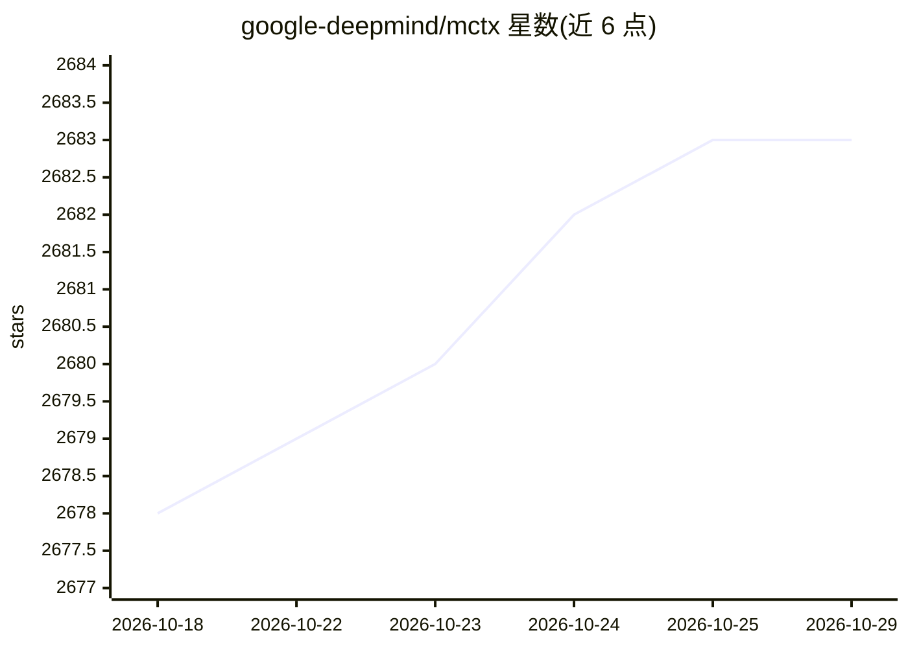

# google-deepmind/mctx

⭐ 2,683 · Python · Apache-2.0 · 推送 2026-10-05 · [GitHub](https://github.com/google-deepmind/mctx) · 组织维护

**JAX 实现的蒙特卡洛树搜索库，服务强化学习研究**

提供 AlphaZero、MuZero、Gumbel MuZero 等蒙特卡洛树搜索算法的 JAX 原生实现，支持 JIT 编译与批量输入并行运算，可结合深度神经网络参数化的环境模型使用。面向希望用 Python 研究搜索类强化学习算法的研究者，避免 C++ 实现的门槛。API 分为底层通用 search 函数与高层 muzero_policy / gumbel_muzero_policy，用户需自行提供表示、动态与预测的学习组件（recurrent_fn、RootFnOutput 等）。以 PyPI 包形式分发，README 附可视化与策略改进示例及多个第三方示例项目。

## 筛选速览

| 维度 | 判定 | 备注 |
|---|---|---|
| AI 角色 | `ai-native` | 本体是模型或模型工具 |
| 许可风险 | `permissive` | Apache-2.0 |
| 部署形态 | `library` | 以包/库形式分发 |
| 模型依赖 | — | README 未给出锁定关系 |
| 硬件要求 | — | 无带数字的原话,不猜 |
| 安装摩擦 | `low` | 无编译、无系统依赖或容器化 |
| 成熟度 | — | 结构信号不足 |

## 能力要点

- AlphaZero / MuZero / Gumbel MuZero 的 JAX 原生实现
- 全面支持 JIT 编译与批量并行搜索
- 底层 search 函数与高层策略 API 双层接口，参数可高度配置
- 提供 Gumbel MuZero 的策略改进保证与配套示例

## 适用场景

- 在 JAX 中为 MuZero 类 agent 实现树搜索策略
- 研究搜索类强化学习算法并自定义搜索配置
- 利用加速器批量并行运行 MCTS 实验

## 场景标签

`强化学习` · 领域:训练与推理

## 证据(README 行号)

> L3: Mctx is a library with a JAX-native
> L4: implementation of Monte Carlo tree search (MCTS) algorithms such as
> L8: speed up, the implementation fully supports JIT-compilation. Search algorithms

## 星数曲线

2026-10-18 2,678 → 2026-10-29 2,683（+5）

---
*卡片 v1 · prompt 1.4 · 生成 2026-10-21 · 置信度 high · 依据 README sha `e824d944c5e2` · [字段定义](../../DATASET.md)*
