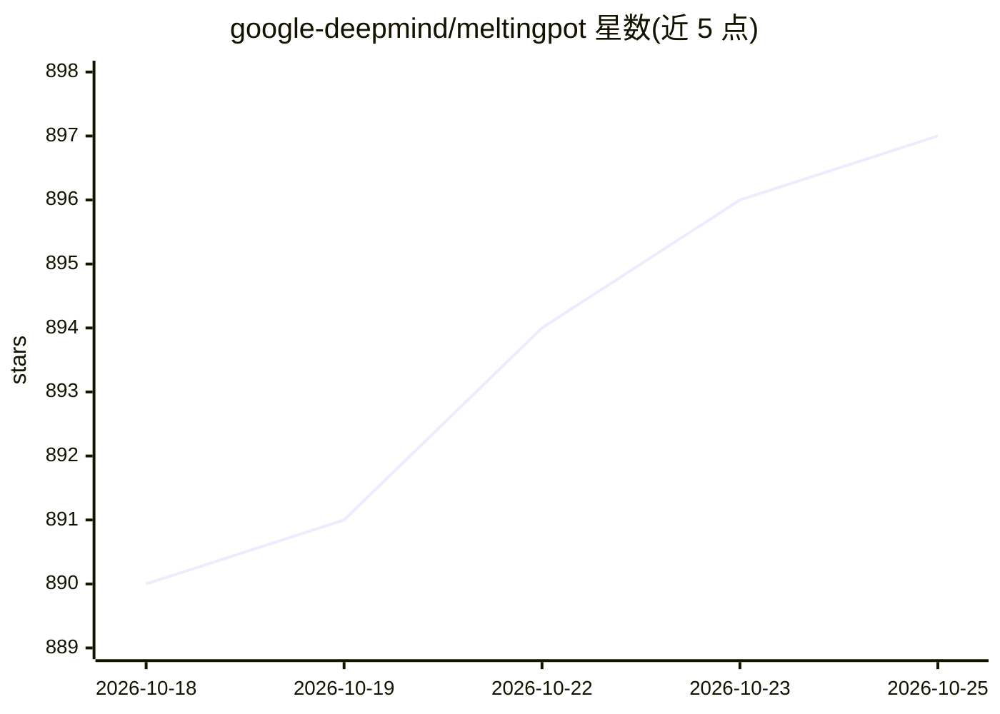

# google-deepmind/meltingpot

⭐ 897 · Python · Apache-2.0 · 推送 2026-10-13 · [GitHub](https://github.com/google-deepmind/meltingpot) · 组织维护

**多智能体强化学习评测基准：50+ substrates、256+ 测试场景**

DeepMind 维护的多智能体强化学习（MARL）评测套件，提供 50 余个 substrate（多智能体游戏）用于训练智能体，以及 256 个以上保留测试场景用于评估泛化能力，覆盖合作、竞争、欺骗、互惠、信任等社会交互类型。测试得分可用来对不同 MARL 算法排序。基于 DeepMind Lab2D 构建（以预编译 wheel 分发，无对应 wheel 时需从源码编译）。通过 PyPI 安装，附评估库、Colab 评估笔记本与可交互 human_players 脚本。

## 筛选速览

| 维度 | 判定 | 备注 |
|---|---|---|
| AI 角色 | `ai-ecosystem` | LLM/agent 周边工具 |
| 许可风险 | `permissive` | Apache-2.0 |
| 部署形态 | `library` | 以包/库形式分发 |
| 模型依赖 | — | README 未给出锁定关系 |
| 硬件要求 | — | 无带数字的原话,不猜 |
| 安装摩擦 | `low` | 无编译、无系统依赖或容器化 |
| 成熟度 | — | 结构信号不足 |

## 能力要点

- 50+ 多智能体 RL substrates 与 256+ 保留测试场景
- 评测在保留场景上的表现以量化社会交互泛化能力
- 提供评估库（评估训练好的 SavedModel）与交互式 human_players 脚本
- 配套 Melting Pot 2.0 技术报告与 NeurIPS 2023 竞赛

## 适用场景

- 在标准化基准上训练和评测我的多智能体 RL 算法
- 检验智能体与陌生个体交互时的泛化能力
- 在 Colab 中查看 Melting Pot 2.0 技术报告的评估结果

## 场景标签

`模型评测` `强化学习` · 领域:评测与运维

## 证据(README 行号)

> L20: Melting Pot assesses generalization to novel social situations involving both
> L33: The resulting score can then be used to rank different multi-agent RL algorithms
> L36: We hope Melting Pot will become a standard benchmark for multi-agent

## 星数曲线

2026-10-18 890 → 2026-10-25 897（+7）

---
*卡片 v1 · prompt 1.4 · 生成 2026-10-21 · 置信度 high · 依据 README sha `2efe2e949dd7` · [字段定义](../../DATASET.md)*
