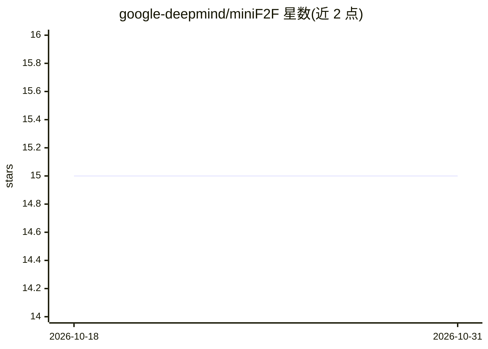

# google-deepmind/miniF2F

⭐ 15 · Lean · Apache-2.0 · 推送 2026-04-23 · [GitHub](https://github.com/google-deepmind/miniF2F) · 组织维护

**形式化奥数基准的 Lean 4 移植版（AlphaProof 评测所用）**

openai/miniF2F 的 fork，将原 Lean 3 题目经 mathport 翻译为 Lean 4，构成跨系统形式化奥林匹克数学基准的维护版本。相比原版：为题目补充自然语言 docstring（来源为 AoPS 论坛题库与 MATH 数据集）便于识别误形式化；移除已知错误命题并强化部分命题以匹配英文原题强度；简化 Minif2fImport 策略改为直接导入全部 mathlib。AlphaProof 在此版本上评测。未给出安装运行命令。

## 筛选速览

| 维度 | 判定 | 备注 |
|---|---|---|
| AI 角色 | `ai-knowledge` | 知识聚合/清单类 |
| 许可风险 | `permissive` | Apache-2.0 |
| 部署形态 | `None` |  |
| 模型依赖 | — | README 未给出锁定关系 |
| 硬件要求 | — | 无带数字的原话,不猜 |
| 安装摩擦 | `low` | 无编译、无系统依赖或容器化 |
| 成熟度 | — | 结构信号不足 |

## 能力要点

- Lean 3 题目经 mathport 翻译为 Lean 4
- 补充源自 AoPS 与 MATH 数据集的自然语言题面
- 移除已知错误命题并强化部分命题
- AlphaProof 所用的基准版本

## 适用场景

- 在 Lean 4 环境下评测定理证明系统
- 研究形式化数学题目的陈述与题面对照
- 复现基于 miniF2F 的证明基准实验

## 场景标签

`模型评测` · 领域:评测与运维

## 证据(README 行号)

> L7: openai/miniF2F, which is described in
> L8: MiniF2F: a cross-system benchmark for formal Olympiad-level mathematics.
> L31: This is the version of the benchmark on which AlphaProof is evaluated.

## 星数曲线

2026-10-18 15 → 2026-10-31 15（+0）

---
*卡片 v1 · prompt 1.4 · 生成 2026-10-31 · 置信度 high · 依据 README sha `3dbb495854d7` · [字段定义](../../DATASET.md)*
