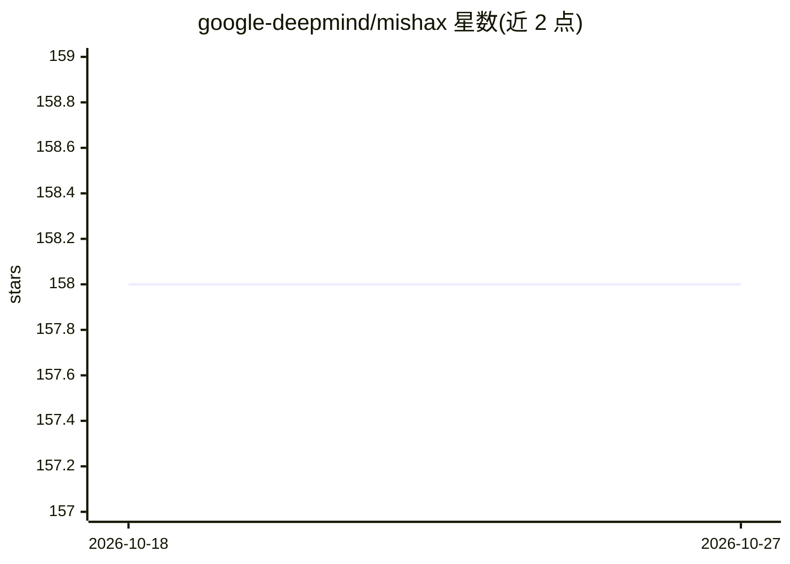

# google-deepmind/mishax

⭐ 158 · Python · Apache-2.0 · 推送 2026-09-16 · [GitHub](https://github.com/google-deepmind/mishax) · 组织维护

**机制可解释性研究工具库：对深度学习代码做源码级插桩**

DeepMind 维护的机制可解释性研究辅助库，含两个模块：ast_patcher 可在不 fork 目标库的情况下，对其他库（如深度学习代码库）运行时施加源码级代码修改，用于在模型中插入探针并在任意位置干预；safe_greenlet 将允许深层回调的复杂函数转为普通 Python for 循环，支持在前向传播中读写模型内部表示，与 JAX 互操作。附 Gemma 代码库插桩示例与 Colab 教程。限制：AST patching 破坏常规抽象，过度使用可能降低可维护性。

## 筛选速览

| 维度 | 判定 | 备注 |
|---|---|---|
| AI 角色 | `ai-ecosystem` | LLM/agent 周边工具 |
| 许可风险 | `permissive` | Apache-2.0 |
| 部署形态 | `library` | 以包/库形式分发 |
| 模型依赖 | — | README 未给出锁定关系 |
| 硬件要求 | — | 无带数字的原话,不猜 |
| 安装摩擦 | `low` | 无编译、无系统依赖或容器化 |
| 成熟度 | — | 结构信号不足 |

## 能力要点

- ast_patcher 无需 fork 即可对目标库施加源码级修改与插桩
- safe_greenlet 用 for 循环读写前向传播中的模型内部表示
- Gemma 参考实现插桩示例与 Colab 教程

## 适用场景

- 对 LLM 代码库插入探针进行机制可解释性实验
- 在 JAX/Flax 前向传播中读取并替换中间表示
- 避免 fork 上游代码做干预实验的维护负担

## 场景标签

`科研工具` · 领域:学习与行业

## 证据(README 行号)

> L5: Mishax is a utility library for mechanistic interpretability research, with its motivations explained in this blog p
> L7: `mishax.ast_patcher` enables running code from some other library (e.g. a deep learning codebase) with some source-l
> L9: `mishax.safe_greenlet`, given a complicated function `f` that allows running arbitrary callbacks somewhere deep insi

## 星数曲线

2026-10-18 158 → 2026-10-27 158（+0）

---
*卡片 v1 · prompt 1.4 · 生成 2026-10-22 · 置信度 high · 依据 README sha `5974ab4759e7` · [字段定义](../../DATASET.md)*
