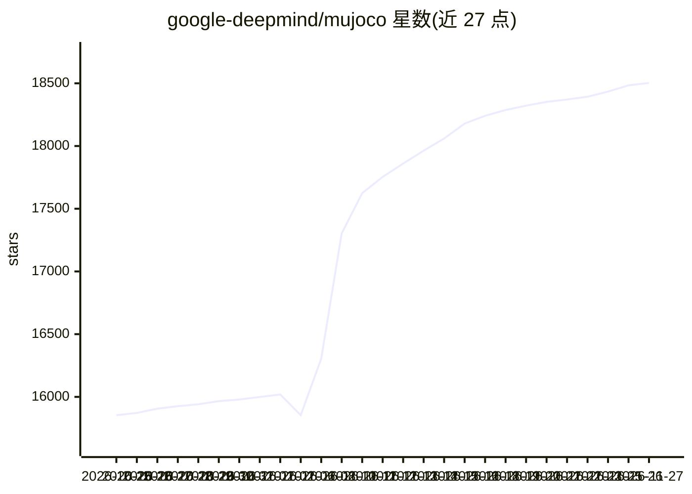

# google-deepmind/mujoco

⭐ 18,503 · C++ · Apache-2.0 · 推送 2026-11-26 · [GitHub](https://github.com/google-deepmind/mujoco) · [官网](https://mujoco.org) · 组织维护

**通用物理引擎：面向机器人与机器学习研究的关节动力学仿真**

MuJoCo（Multi-Joint dynamics with Contact）是由 Google DeepMind 维护的通用物理引擎，用于对铰接结构与环境交互进行快速仿真，面向机器人、生物力学、图形动画与机器学习等领域的研究者和开发者。提供 C API 与预分配低层数据结构的运行时模块，支持原生桌面窗口与浏览器中的交互可视化，提供 Python 绑定与 Unity 插件。安装方式包括 GitHub 预编译二进制（Linux x86-64/AArch64、Windows x86-64、macOS universal）、源码构建及 PyPI 的 pip 包（需 Python >= 3.11）。

## 筛选速览

| 维度 | 判定 | 备注 |
|---|---|---|
| AI 角色 | `ai-enhanced` | 去掉 AI 部分产品仍成立 |
| 许可风险 | `permissive` | Apache-2.0 |
| 部署形态 | `desktop` | 安装包/桌面程序 |
| 模型依赖 | — | README 未给出锁定关系 |
| 硬件要求 | — | 无带数字的原话,不猜 |
| 安装摩擦 | `low` | 无编译、无系统依赖或容器化 |
| 成熟度 | — | 结构信号不足 |

## 动量与使用信号

- 维护:`active` — 距上次 push 0.9 天,年发版 14,162 位贡献者
- 涨星:近 1 天 **+25**(自 20261016 起算)
- 安装:pypi 包 `mujoco` 月下载 4,023,561
- 平台:WINDOWS / MACOS / LINUX · 协议:—

## 能力要点

- 提供 C API、原生 Python 绑定及 Unity 插件
- 支持桌面窗口与浏览器的交互式可视化（WebAssembly 版本）
- 每月发布版本，提供 Linux/Windows/macOS 预编译二进制
- 提供 GPU 加速 RL 训练路径（MuJoCo Playground、MJX）与多语言第三方绑定

## 适用场景

- 机器人控制策略的仿真训练与 sim-to-real 部署
- 生物力学与铰接结构动力学研究仿真
- 图形动画中的物理效果模拟
- 通过浏览器零安装体验与编辑 MJCF 模型

## 场景标签

 · 领域:机器人/物理仿真

## 证据(README 行号)

> L16: **MuJoCo** stands for **Mu**lti-**Jo**int dynamics with **Co**ntact. It is a
> L18: in robotics, biomechanics, graphics and animation, machine learning, and other
> L69: 4. **Train and deploy robot policies.**

## 星数曲线

2026-10-25 15,854 → 2026-11-27 18,503（+2,649）

---
*卡片 v1 · prompt 1.4 · 生成 2026-11-22 · 置信度 high · 依据 README sha `2587c7dff469` · [字段定义](../../DATASET.md)*
