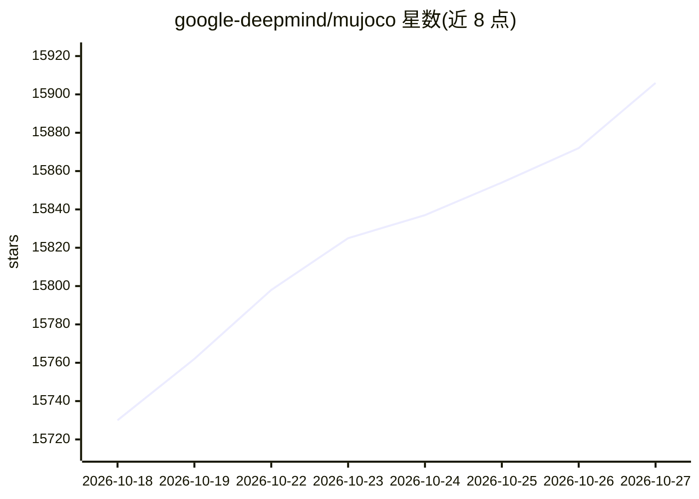

# google-deepmind/mujoco

⭐ 15,906 · C++ · Apache-2.0 · 推送 2026-10-26 · [GitHub](https://github.com/google-deepmind/mujoco) · [官网](https://mujoco.org) · 组织维护

**面向机器人与仿真研究的通用多关节接触动力学物理引擎**

MuJoCo（Multi-Joint dynamics with Contact）是一个通用物理引擎，服务于机器人、生物力学、图形动画、机器学习等需要对铰接结构与环境交互进行快速精确仿真的领域。提供 C API，运行时仿真模块基于内置 XML 编译器预分配的底层数据结构运作，含 OpenGL 原生交互可视化 GUI 与物理量计算工具函数。提供 Python 绑定与 Unity 插件，版本化发布每月一次，由 Google DeepMind 维护。

## 筛选速览

| 维度 | 判定 | 备注 |
|---|---|---|
| AI 角色 | `ai-ecosystem` | LLM/agent 周边工具 |
| 许可风险 | `permissive` | Apache-2.0 |
| 部署形态 | `desktop` | 安装包/桌面程序 |
| 模型依赖 | — | README 未给出锁定关系 |
| 硬件要求 | — | 无带数字的原话,不猜 |
| 安装摩擦 | `low` | 无编译、无系统依赖或容器化 |
| 成熟度 | — | 结构信号不足 |

## 动量与使用信号

- 维护:`active` — 距上次 push 0.9 天,年发版 14,162 位贡献者
- 涨星:近 1 天 **+25**(自 20261016 起算)
- 安装:pypi 包 `mujoco` 月下载 4,023,561
- 平台:WINDOWS / MACOS / LINUX · 协议:—

## 能力要点

- 提供 C API 与官方 Python 绑定（pip install mujoco）
- 含 OpenGL 原生交互式可视化查看器 simulate
- MJX 分支基于 JAX 编写，支持可微物理教程
- 提供 Unity 插件及 JS/C#/MATLAB 等第三方绑定

## 适用场景

- 机器人强化学习训练环境的物理仿真
- 生物力学中的铰接结构动力学建模
- 为图形动画与游戏引擎提供物理仿真
- 在 Colab 中学习可微物理与控制器综合

## 场景标签

 · 领域:科研仿真/机器人

## 证据(README 行号)

> L13: **MuJoCo** stands for **Mu**lti-**Jo**int dynamics with **Co**ntact. It is a
> L19: This repository is maintained by Google DeepMind.
> L21: MuJoCo has a C API and is intended for researchers and developers. The runtime

## 星数曲线

2026-10-18 15,730 → 2026-10-27 15,906（+176）

---
*卡片 v1 · prompt 1.4 · 生成 2026-10-18 · 置信度 high · 依据 README sha `0462d756e200` · [字段定义](../../DATASET.md)*
