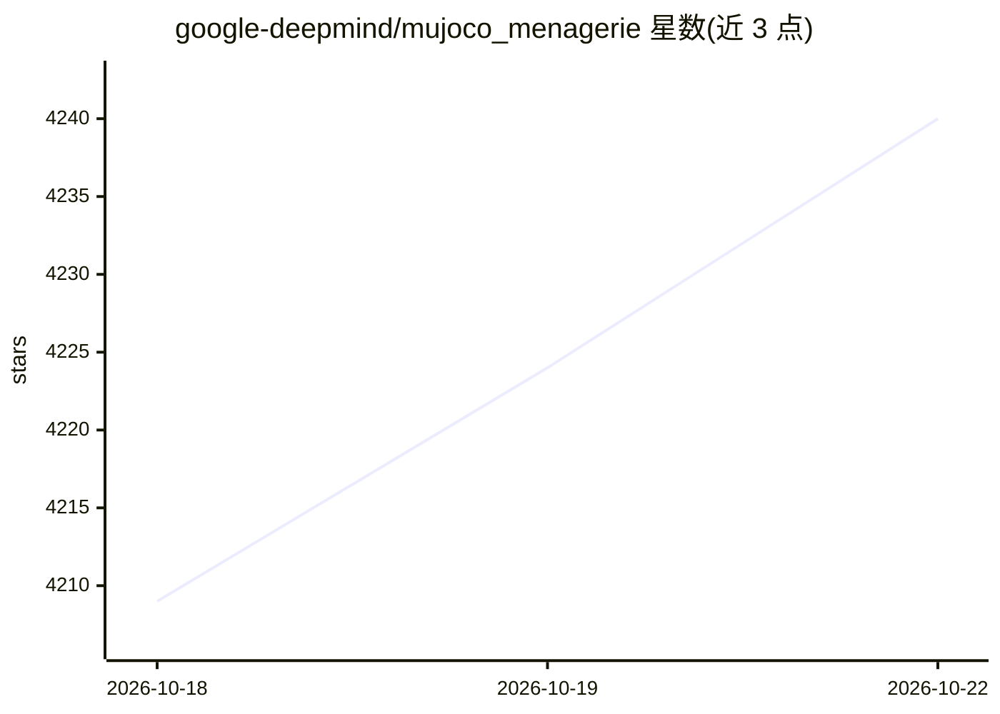

# google-deepmind/mujoco_menagerie

⭐ 4,240 · Python · NOASSERTION · 推送 2026-10-20 · [GitHub](https://github.com/google-deepmind/mujoco_menagerie) · 组织维护

**Google DeepMind 维护的 MuJoCo 机器人仿真模型库**

面向 MuJoCo 物理引擎用户的精选模型合集：收录人形、四足、双足、机械臂、末端执行器、无人机等类别的机器人 MJCF 模型，每个模型目录含网格资产、许可文件与生成说明，部分提供 MJX 兼容变体。使用方式包括直接 git clone、pip 安装 mujoco-menagerie Python 包（按需下载并编译场景）或 uvx 命令行查看。设有 A+ 至 C 的模型质量分级体系，各模型指定最低 MuJoCo 版本要求。

## 筛选速览

| 维度 | 判定 | 备注 |
|---|---|---|
| AI 角色 | `ai-knowledge` | 知识聚合/清单类 |
| 许可风险 | `none` | NOASSERTION |
| 部署形态 | `desktop` | 安装包/桌面程序 |
| 模型依赖 | — | README 未给出锁定关系 |
| 硬件要求 | — | 无带数字的原话,不猜 |
| 安装摩擦 | `medium` | 含编译或系统依赖之一 |
| 成熟度 | — | 结构信号不足 |

## 能力要点

- 覆盖人形/四足/机械臂/末端执行器等多类机器人 MJCF 模型
- pip/uvx 安装的 Python 包按需下载模型并编译场景
- 部分模型提供 MJX 兼容变体
- A+ 至 C 模型质量分级体系

## 适用场景

- 机器人仿真研究与强化学习实验获取现成模型
- 在 MuJoCo viewer 中交互查看机器人模型
- 通过 robot_descriptions 等第三方包引用模型

## 场景标签

 · 领域:机器人/物理仿真

## 证据(README 行号)

> L16: **Menagerie** is a collection of high-quality models for the
> L22: "bad" models which do not behave as expected. The goal of this collection is to

## 星数曲线

2026-10-18 4,209 → 2026-10-22 4,240（+31）

---
*卡片 v1 · prompt 1.4 · 生成 2026-10-20 · 置信度 high · 依据 README sha `ac1b797b4bc5` · [字段定义](../../DATASET.md)*
