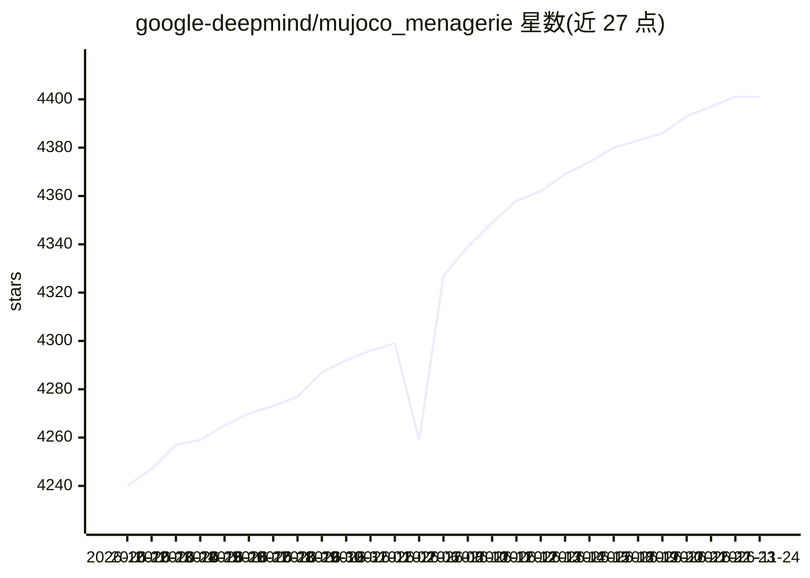

# google-deepmind/mujoco_menagerie

⭐ 4,411 · Python · NOASSERTION · 推送 2026-11-24 · [GitHub](https://github.com/google-deepmind/mujoco_menagerie) · 组织维护

**为 MuJoCo 物理引擎提供社区精选的机器人仿真模型库**

由 Google DeepMind 维护的 MuJoCo 模型合集，收录人形、四足、双足、机械臂、灵巧手、无人机等机器人模型的 MJCF XML 定义、网格资产与场景文件，各模型标注自由度数与许可证。提供 Python 包（pip install mujoco-menagerie，按需下载到用户缓存）与 git clone 两种使用方式，部分模型提供 MJX 兼容变体；模型按参数真实程度分为 A+ 至 C 的分级体系，并接受社区贡献。

## 筛选速览

| 维度 | 判定 | 备注 |
|---|---|---|
| AI 角色 | `ai-knowledge` | 知识聚合/清单类 |
| 许可风险 | `none` | NOASSERTION |
| 部署形态 | `desktop` | 安装包/桌面程序 |
| 模型依赖 | — | README 未给出锁定关系 |
| 硬件要求 | — | 无带数字的原话,不猜 |
| 安装摩擦 | `medium` | 含编译或系统依赖之一 |
| 成熟度 | — | 结构信号不足 |

## 能力要点

- 覆盖人形/四足/机械臂/灵巧手/无人机等多类机器人模型，标注自由度与许可证
- 提供 mujoco-menagerie Python 包，首次加载自动下载到用户缓存
- 部分模型含 MJX 兼容变体（scene_mjx.xml）
- 模型质量分级体系（A+/A/B/C）与贡献者 CI 检查流程

## 适用场景

- 为 MuJoCo 强化学习或机器人控制研究加载现成机器人模型
- 在 Python viewer 中交互式查看机器人仿真场景
- 为机器人仿真项目贡献或复用经过整编的 MJCF 模型

## 场景标签

 · 领域:机器人/物理仿真

## 证据(README 行号)

> L16: **Menagerie** is a collection of high-quality models for the
> L23: provide the community with a curated library of well-designed models that work

## 星数曲线

2026-10-22 4,240 → 2026-11-24 4,401（+161）

---
*卡片 v1 · prompt 1.4 · 生成 2026-11-24 · 置信度 high · 依据 README sha `c7982c828858` · [字段定义](../../DATASET.md)*
