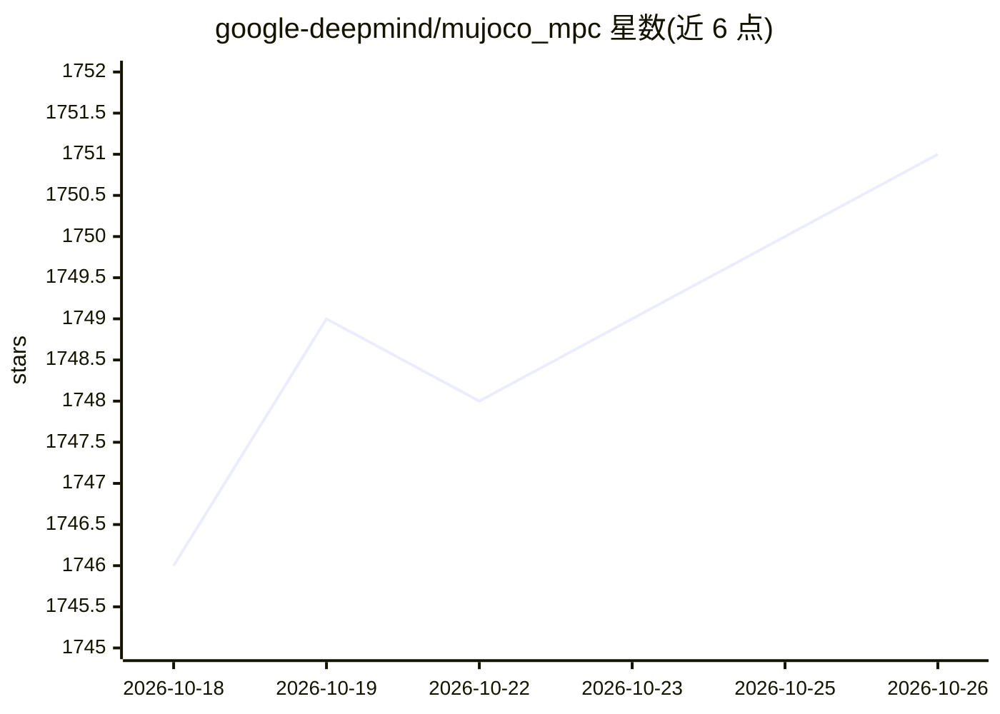

# google-deepmind/mujoco_mpc

⭐ 1,751 · C++ · Apache-2.0 · 推送 2026-10-07 · [GitHub](https://github.com/google-deepmind/mujoco_mpc) · [官网](https://github.com/deepmind/mujoco_mpc) · 组织维护

**基于 MuJoCo 的实时预测控制（MPC）交互应用与框架**

Google DeepMind 开发的实时预测控制软件：提供交互式 GUI 应用与 C++ 框架，用于编写并求解机器人任务，含多种基于导数（iLQG、Gradient Descent）与无导数（Predictive Sampling）的规划器。支持四足、双臂操作、魔方还原、人体动捕跟踪等示例任务。源码 CMake 编译运行，另有实验性 Python API（需 Python 3.10，要求模型与任务残差/转移函数手工兼容，缺少错误处理）。官方声明为研究原型，非生产级软件。

## 筛选速览

| 维度 | 判定 | 备注 |
|---|---|---|
| AI 角色 | `ai-ecosystem` | LLM/agent 周边工具 |
| 许可风险 | `permissive` | Apache-2.0 |
| 部署形态 | `library` | 以包/库形式分发 |
| 模型依赖 | — | README 未给出锁定关系 |
| 硬件要求 | — | 无带数字的原话,不猜 |
| 安装摩擦 | `medium` | 含编译或系统依赖之一 |
| 成熟度 | `idea` | |

## 能力要点

- 支持 iLQG、Gradient Descent、Predictive Sampling 等多种规划器
- 交互式 GUI 应用于创作与求解机器人任务
- 提供实验性 Python API 与示例脚本
- 示例任务含四足行走、双臂操作、魔方还原、动捕跟踪

## 适用场景

- 机器人任务的实时预测控制研究与实验
- 通过 GUI 交互式设计与调试控制任务
- 用 Python API 在脚本中调用 MJPC 求解器

## 场景标签

 · 领域:机器人/控制与仿真

## 证据(README 行号)

> L10: **MuJoCo MPC (MJPC)** is an interactive application and software framework for
> L14: MJPC allows the user to easily author and solve complex robotics tasks, and
> L15: currently supports multiple shooting-based planners. Derivative-based methods include iLQG and

## 星数曲线

2026-10-18 1,746 → 2026-10-26 1,751（+5）

---
*卡片 v1 · prompt 1.4 · 生成 2026-10-21 · 置信度 mid · 依据 README sha `e7e5570388ca` · [字段定义](../../DATASET.md)*
