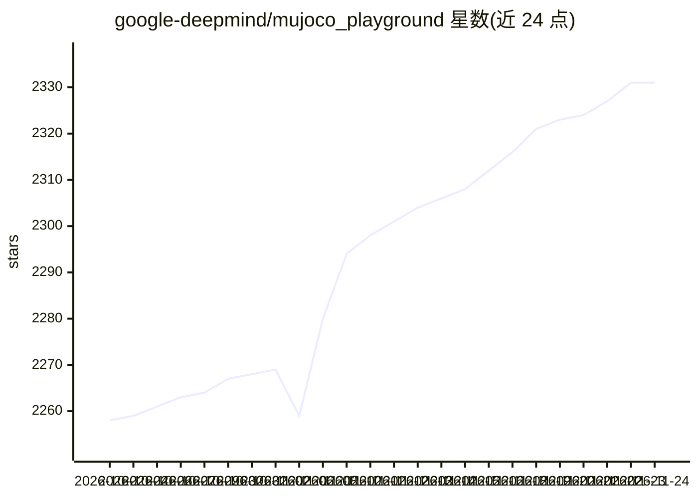

# google-deepmind/mujoco_playground

⭐ 2,331 · Python · Apache-2.0 · 推送 2026-11-21 · [GitHub](https://github.com/google-deepmind/mujoco_playground) · [官网](https://playground.mujoco.org) · 组织维护

**面向机器人研究者的仿真-真机 RL 环境与工作流库**

MuJoCo 团队维护的机器人环境套件，用 PyTorch 编写，构建于 MuJoCo 与 MuJoCo Warp 之上，覆盖控制、操作与人形全身跟踪任务。支持 GPU 大批量 RL 训练、leader-follower 遥操作与 MCAP 日志、系统辨识（mujoco.sysid）、零样本 sim-to-real 策略部署（同一任务层以 --mode=sim/real 切换），并提供 VLM 桌面操作示例（SO-101、i2rt YAM）。安装走 PyPI/uv，硬件 SDK 为可选 extras，RSS 2025 JAX/MJX 环境保留在 rss2025 目录。

## 筛选速览

| 维度 | 判定 | 备注 |
|---|---|---|
| AI 角色 | `ai-native` | 本体是模型或模型工具 |
| 许可风险 | `permissive` | Apache-2.0 |
| 部署形态 | `library` | 以包/库形式分发 |
| 模型依赖 | — | README 未给出锁定关系 |
| 硬件要求 | — | 无带数字的原话,不猜 |
| 安装摩擦 | `medium` | 含编译或系统依赖之一 |
| 成熟度 | — | 结构信号不足 |

## 能力要点

- 覆盖控制、操作、人形全身跟踪的 RL 环境与 GPU 大批量训练
- 同一任务层与策略在仿真与硬件间切换（--mode=sim/real）
- 系统辨识：用 mujoco.sysid 将仿真关节动力学拟合到真机轨迹
- 提供 train/play/deploy/teleop/sysid/view_log 六个 CLI 命令

## 适用场景

- 在 GPU 上并行训练机械臂抓取等 PPO 策略并部署到真机
- 用编码 agent 通过 prompt 启动 sim/real 桌面操作任务
- 从真机日志辨识仿真关节动力学参数
- 配合 SO-101/YAM 硬件做遥操作与 sim-to-real 实验

## 场景标签

`强化学习` · 领域:训练与推理

## 证据(README 行号)

> L9: MuJoCo Playground is a suite of robot environments, reinforcement learning tasks, and hardware workflows written in 
> L54: To get started, try controlling a sim/real robot with your coding agent, or train an RL policy in sim and deploy it
> L67: ### Train, visualize, and deploy an RL policy

## 星数曲线

2026-10-22 2,258 → 2026-11-24 2,331（+73）

---
*卡片 v1 · prompt 1.4 · 生成 2026-11-23 · 置信度 high · 依据 README sha `684f7a2e8c8f` · [字段定义](../../DATASET.md)*
