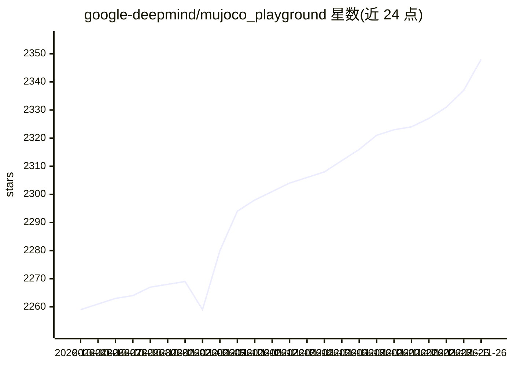

# google-deepmind/mujoco_playground

⭐ 2,348 · Python · Apache-2.0 · 推送 2026-11-25 · [GitHub](https://github.com/google-deepmind/mujoco_playground) · [官网](https://playground.mujoco.org) · 组织维护

**面向机器人研究者的仿真到实机强化学习环境与工作流库**

由 MuJoCo 团队构建的机器人环境、强化学习任务与硬件工作流套件，基于 reaf-sim、MuJoCo 与 MuJoCo Warp。提供全身运动跟踪、SO-101 遥操作、系统辨识、Sim2Real 与桌面操作等环境，支持用 RSL-RL 训练 PPO 策略并在 MuJoCo Studio 查看器中检查、零样本部署到真实硬件。硬件 SDK 作为可选扩展安装，仿真路径保持轻量；提供 CLI（train/play/deploy/teleop/sysid/view_log）与 Colab 快速开始。Python 3.12–3.14。

## 筛选速览

| 维度 | 判定 | 备注 |
|---|---|---|
| AI 角色 | `ai-native` | 本体是模型或模型工具 |
| 许可风险 | `permissive` | Apache-2.0 |
| 部署形态 | `library` | 以包/库形式分发 |
| 模型依赖 | — | README 未给出锁定关系 |
| 硬件要求 | — | 无带数字的原话,不猜 |
| 安装摩擦 | `medium` | 含编译或系统依赖之一 |
| 成熟度 | — | 结构信号不足 |

## 能力要点

- 覆盖 sim 与 real 的端到端工作流（训练、可视化、部署、遥操作、系统辨识）
- GPU 并行训练 RL 策略（CUDA 12/13 路径，支持 8,192 并行环境）
- 可通过编码 agent 以提示词启动机器人任务桥（sim 或 real）
- 硬件 SDK（so101/yam）为可选扩展，按需安装驱动

## 适用场景

- 在仿真中训练机械臂抓取策略并零样本部署到实机
- 对 SO-101 等硬件做遥操作与系统辨识实验
- 用 Colab 快速上手而无需本地安装
- 通过编码 agent 以自然语言指令控制机器人任务

## 场景标签

`强化学习` · 领域:训练与推理

## 证据(README 行号)

> L10: MuJoCo Playground is a suite of robot environments, reinforcement learning tasks, and hardware workflows built by t
> L172:   title = {MuJoCo Playground: An open-source framework for GPU-accelerated robot learning and sim-to-real transfer

## 星数曲线

2026-10-24 2,259 → 2026-11-26 2,348（+89）

---
*卡片 v1 · prompt 1.4 · 生成 2026-11-24 · 置信度 high · 依据 README sha `a77dd0984390` · [字段定义](../../DATASET.md)*
