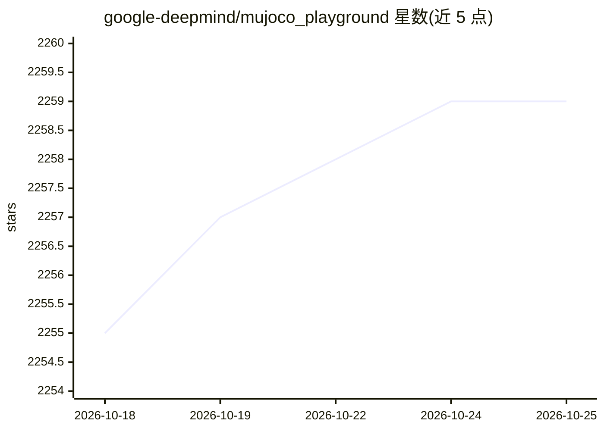

# google-deepmind/mujoco_playground

⭐ 2,261 · Python · Apache-2.0 · 推送 2026-10-24 · [GitHub](https://github.com/google-deepmind/mujoco_playground) · 组织维护

**GPU 加速的机器人学习环境套件，支持 sim-to-real 迁移**

基于 MuJoCo MJX 构建的 GPU 加速机器人学习环境库，收录 dm_control 经典控制、四足/双足运动、非抓取与灵巧操作等环境，并通过 MJWarp 批量渲染器提供视觉支持。面向机器人学习研究者，支持 MuJoCo MJX（JAX）与 MuJoCo Warp 两种后端，提供 CLI 训练脚本（PPO）、Colab 教程与 rscope 训练可视化。限制：从源码安装需 Python 3.10+ 与 CUDA 12 的 JAX；NVIDIA Ampere GPU 上存在 TF32 精度导致的复现性问题。

## 筛选速览

| 维度 | 判定 | 备注 |
|---|---|---|
| AI 角色 | `ai-ecosystem` | LLM/agent 周边工具 |
| 许可风险 | `permissive` | Apache-2.0 |
| 部署形态 | `library` | 以包/库形式分发 |
| 模型依赖 | — | README 未给出锁定关系 |
| 硬件要求 | — | 无带数字的原话,不猜 |
| 安装摩擦 | `medium` | 含编译或系统依赖之一 |
| 成熟度 | — | 结构信号不足 |

## 能力要点

- 覆盖经典控制、四足/双足运动与灵巧操作的环境集合
- 支持 MuJoCo MJX（JAX）与 MuJoCo Warp 双后端训练
- MJWarp 批量渲染器提供视觉环境支持
- 提供 CLI 训练命令、Colab 教程与 rscope 可视化

## 适用场景

- 在 GPU 上大规模并行训练机器人 RL 策略
- 将仿真中训练的策略迁移到真实机器人（sim-to-real）
- 跟随 Colab 教程快速上手运动/操作/视觉环境

## 场景标签

`强化学习` · 领域:训练与推理

## 证据(README 行号)

> L7: A comprehensive suite of GPU-accelerated environments for robot learning research and sim-to-real, built with MuJoCo
> L11: - Classic control environments from `dm_control`.
> L12: - Quadruped and bipedal locomotion environments.
> L13: - Non-prehensile and dexterous manipulation environments.

## 星数曲线

2026-10-18 2,255 → 2026-10-25 2,259（+4）

---
*卡片 v1 · prompt 1.4 · 生成 2026-10-21 · 置信度 high · 依据 README sha `545feb04a446` · [字段定义](../../DATASET.md)*
