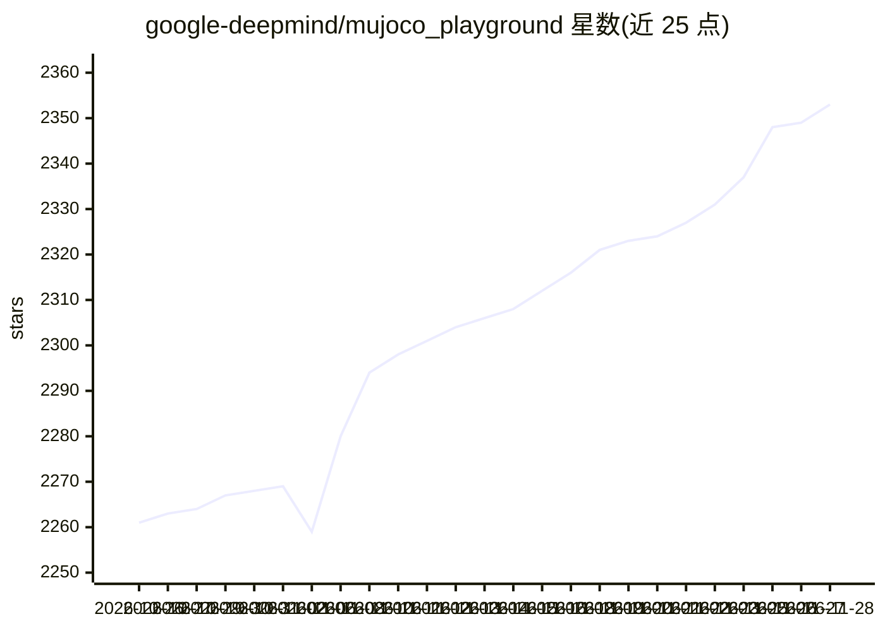

# google-deepmind/mujoco_playground

⭐ 2,353 · Python · Apache-2.0 · 推送 2026-11-27 · [GitHub](https://github.com/google-deepmind/mujoco_playground) · [官网](https://playground.mujoco.org) · 组织维护

**MuJoCo 团队维护的机器人仿真与实机 RL 环境工作流库**

由 MuJoCo 团队构建的机器人环境、强化学习任务与硬件工作流套件，基于 reaf-sim、MuJoCo 与 MuJoCo Warp。机器人定义存放于 mujoco_playground/robots/，涵盖仿真与配对硬件版本，支持全身运动跟踪、SO-101 遥操作、系统辨识、Sim2Real 迁移与桌面操作任务。提供 train/play/deploy/teleop/sysid 等命令行接口，用 RSL-RL 训练 PPO 策略并在 MuJoCo Studio 网页查看器中观察，可零样本部署到硬件。Python 3.12–3.14，硬件 SDK 为可选附加项以保持纯仿真安装轻量。

## 筛选速览

| 维度 | 判定 | 备注 |
|---|---|---|
| AI 角色 | `ai-native` | 本体是模型或模型工具 |
| 许可风险 | `permissive` | Apache-2.0 |
| 部署形态 | `library` | 以包/库形式分发 |
| 模型依赖 | — | README 未给出锁定关系 |
| 硬件要求 | — | 无带数字的原话,不猜 |
| 安装摩擦 | `medium` | 含编译或系统依赖之一 |
| 成熟度 | — | 结构信号不足 |

## 能力要点

- 仿真与实机端到端工作流：训练、可视化、部署（train/play/deploy/teleop/sysid）
- RSL-RL PPO 策略训练，支持 CPU、CUDA 12/13 GPU（8,192 并行环境）
- 通过编码 agent 的提示词直接启动桌面操作任务（sim 或 real 模式）
- 硬件 SDK（so101/yam）为可选 extras，纯仿真安装保持轻量

## 适用场景

- 训练 RL 策略并零样本部署到 SO-101/YAM 实体机械臂
- 用编码 agent 通过提示词控制仿真或真实机器人
- 研究 sim-to-real 迁移与机器人系统辨识
- 在 Colab 中无需本地安装即可体验交互式快速入门

## 场景标签

`强化学习` · 领域:训练与推理

## 证据(README 行号)

> L10: MuJoCo Playground is a suite of robot environments, reinforcement learning tasks, and hardware workflows built by t
> L49: Try the interactive Quickstart Colab (no local install required), control a sim/real robot with your coding agent, 

## 星数曲线

2026-10-26 2,261 → 2026-11-28 2,353（+92）

---
*卡片 v1 · prompt 1.4 · 生成 2026-11-26 · 置信度 high · 依据 README sha `43513f24313a` · [字段定义](../../DATASET.md)*
