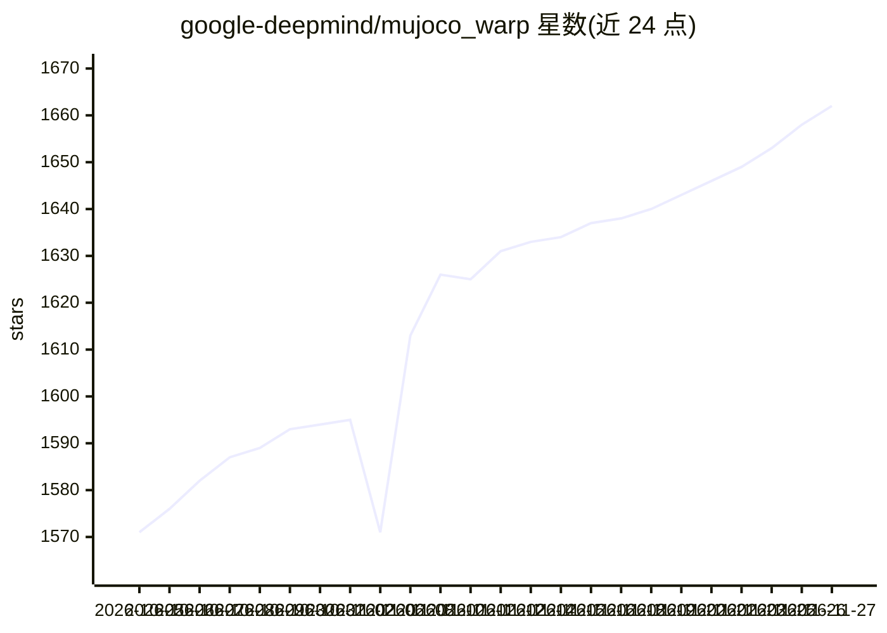

# google-deepmind/mujoco_warp

⭐ 1,662 · Python · Apache-2.0 · 推送 2026-11-26 · [GitHub](https://github.com/google-deepmind/mujoco_warp) · 组织维护

**面向机器人研究的 GPU 加速 MuJoCo 物理仿真器**

MuJoCo 物理仿真器的 GPU 加速实现，由 Google DeepMind 与 NVIDIA 在 Newton 项目下维护，面向机器人研究提供高吞吐仿真。支持刚体接触、软体、布料、符号距离场等物理系统；提供 GPU 批量渲染器，支持网格、纹理、高度场、高斯泼溅与多相机并行渲染，可选 Optix 硬件光线追踪。可作为 MuJoCo 的替代接入使用，但有特性差异：不支持 IMPLICITFAST 积分器、PGS 求解器、PLUGIN 执行器/传感器，可微性尚未提供。快速仿真需 NVIDIA GPU，CPU 仅用于开发调试。

## 筛选速览

| 维度 | 判定 | 备注 |
|---|---|---|
| AI 角色 | `ai-native` | 本体是模型或模型工具 |
| 许可风险 | `permissive` | Apache-2.0 |
| 部署形态 | `library` | 以包/库形式分发 |
| 模型依赖 | — | README 未给出锁定关系 |
| 硬件要求 | — | 无带数字的原话,不猜 |
| 安装摩擦 | `low` | 无编译、无系统依赖或容器化 |
| 成熟度 | — | 结构信号不足 |

## 能力要点

- 面向 NVIDIA GPU 的高吞吐物理仿真，CPU 支持开发调试
- GPU 批量渲染器支持多相机异构配置与可选 Optix 光线追踪
- 与 MuJoCo API 基本兼容，可作 drop-in 替换，差异点明确列出
- 提供 PyTorch（Playground/Isaac Lab/mjlab）与 JAX（MJX）生态集成路径

## 适用场景

- 机器人研究中的大规模并行物理仿真
- GPU 上并行渲染多个仿真世界的相机画面
- 与 Isaac Lab 等框架配合做 GPU 加速 RL 训练

## 场景标签

 · 领域:机器人/物理仿真

## 证据(README 行号)

> L8: MJWarp is a GPU-accelerated version of the MuJoCo physics simulator, designed for NVIDIA hardware. MJWarp delivers h
> L95: There are many ways to use MuJoCo Warp in your projects. In many cases, you can directly install and use MJWarp as 

## 星数曲线

2026-10-25 1,571 → 2026-11-27 1,662（+91）

---
*卡片 v1 · prompt 1.4 · 生成 2026-11-27 · 置信度 mid · 依据 README sha `30f8f7a531d9` · [字段定义](../../DATASET.md)*
