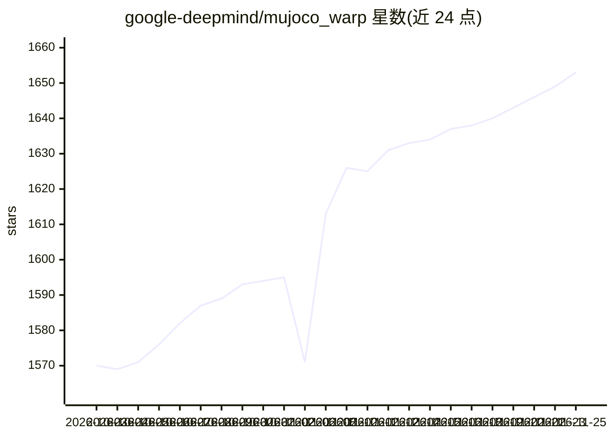

# google-deepmind/mujoco_warp

⭐ 1,653 · Python · Apache-2.0 · 推送 2026-11-23 · [GitHub](https://github.com/google-deepmind/mujoco_warp) · 组织维护

**面向机器人研究的 GPU 加速 MuJoCo 物理仿真器**

MuJoCo 物理仿真器的 GPU 加速实现，由 Google DeepMind 与 NVIDIA 作为 Newton 项目的一部分维护，面向机器人研究提供高吞吐仿真。支持刚体、软体、布料、符号距离场等物理系统仿真；包含面向多并行仿真世界相机渲染的 GPU 批量渲染器，可在 NVIDIA GPU 上以百万帧率级渲染场景。可作为 MuJoCo 的替代直接安装使用，亦可经 MJX（JAX）、Isaac Lab 或 mjlab（PyTorch）接入；部分 MuJoCo 特性（IMPLICITFAST、PGS、PLUGIN、可微性）尚不支持。

## 筛选速览

| 维度 | 判定 | 备注 |
|---|---|---|
| AI 角色 | `ai-ecosystem` | LLM/agent 周边工具 |
| 许可风险 | `permissive` | Apache-2.0 |
| 部署形态 | `library` | 以包/库形式分发 |
| 模型依赖 | — | README 未给出锁定关系 |
| 硬件要求 | — | 无带数字的原话,不猜 |
| 安装摩擦 | `low` | 无编译、无系统依赖或容器化 |
| 成熟度 | — | 结构信号不足 |

## 能力要点

- GPU 加速的高吞吐物理仿真，支持刚体/软体/布料/SDF 等系统
- GPU 批量渲染器：mesh、纹理、高度场、高斯泼溅、多相机异构支持
- 可作为 MuJoCo 的直接替代（drop-in replacement）使用
- 支持经 MJX（JAX）、Isaac Lab（Newton）、mjlab（PyTorch）集成

## 适用场景

- 机器人研究中的并行高吞吐物理仿真
- 在 JAX 或 PyTorch 工作流中接入 MuJoCo 仿真
- 多并行仿真世界的相机批量渲染

## 场景标签

 · 领域:机器人/物理仿真

## 证据(README 行号)

> L8: MJWarp is a GPU-accelerated version of the MuJoCo physics simulator, designed for NVIDIA hardware. MJWarp delivers h
> L97: If you prefer the JAX ecosystem, you can use MJWarp via MJX. See MuJoCo Playground for robotics machine learning re
> L101: * Isaac Lab integrates MJWarp via Newton. This setup enables powerful, highly extensible multi-physics simulation 

## 星数曲线

2026-10-23 1,570 → 2026-11-25 1,653（+83）

---
*卡片 v1 · prompt 1.4 · 生成 2026-11-23 · 置信度 high · 依据 README sha `d22bf325e728` · [字段定义](../../DATASET.md)*
