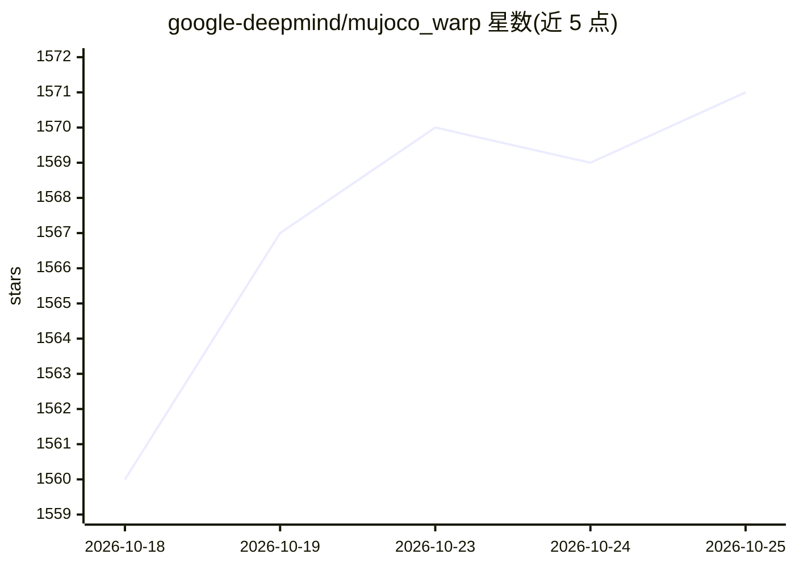

# google-deepmind/mujoco_warp

⭐ 1,571 · Python · Apache-2.0 · 推送 2026-10-24 · [GitHub](https://github.com/google-deepmind/mujoco_warp) · 组织维护

**面向 NVIDIA GPU 的 MuJoCo 物理仿真加速版，服务机器人研究**

由 Google DeepMind 与 NVIDIA 作为 Newton 项目一部分维护的 GPU 加速物理仿真器，基于 NVIDIA Warp 实现 MuJoCo 的高吞吐仿真，覆盖刚体接触、软体、布料、SDF 等；要求 NVIDIA GPU 获得快速仿真，CPU 可用于开发调试。可作为 MuJoCo 的直接替代安装，也可经 MJX 用于 JAX 生态、经 Newton 接入 Isaac Lab，或配合 mjlab 用于 PyTorch 机器人研究。部分 MuJoCo 功能尚未支持（IMPLICITFAST 积分器、PGS 求解器、PLUGIN 类型等），Warp 可微性尚不可用；另含 GPU 批量渲染器。

## 筛选速览

| 维度 | 判定 | 备注 |
|---|---|---|
| AI 角色 | `ai-ecosystem` | LLM/agent 周边工具 |
| 许可风险 | `permissive` | Apache-2.0 |
| 部署形态 | `library` | 以包/库形式分发 |
| 模型依赖 | — | README 未给出锁定关系 |
| 硬件要求 | — | 无带数字的原话,不猜 |
| 安装摩擦 | `low` | 无编译、无系统依赖或容器化 |
| 成熟度 | — | 结构信号不足 |

## 能力要点

- GPU 加速高吞吐仿真，支持刚体/软体/布料/SDF
- 可作为 MuJoCo 的直接替代（drop-in replacement）安装
- GPU 批量渲染器，支持多并行世界多相机光线追踪渲染
- 经 MJX 接入 JAX、经 Newton 接入 Isaac Lab

## 适用场景

- 机器人物理仿真研究的高吞吐并行环境
- 需要大规模并行渲染多个仿真世界相机画面
- 在 JAX/PyTorch 机器人学习工作流中使用 MuJoCo 模型

## 场景标签

 · 领域:机器人/物理仿真

## 证据(README 行号)

> L8: MJWarp is a GPU-accelerated version of the MuJoCo physics simulator, designed for NVIDIA hardware. MJWarp delivers h
> L91: If you prefer the JAX ecosystem, you can use MJWarp via MJX. See MuJoCo Playground for robotics machine learning re

## 星数曲线

2026-10-18 1,560 → 2026-10-25 1,571（+11）

---
*卡片 v1 · prompt 1.4 · 生成 2026-10-21 · 置信度 high · 依据 README sha `c9e1e55d50f8` · [字段定义](../../DATASET.md)*
