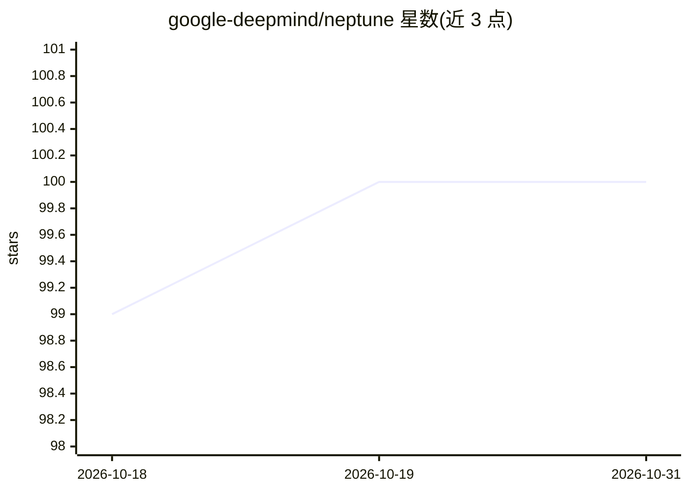

# google-deepmind/neptune

⭐ 100 · Apache-2.0 · 推送 2026-04-28 · [GitHub](https://github.com/google-deepmind/neptune) · 组织维护

**长视频推理评测数据集合集：4 个视频问答基准数据集**

DeepMind 维护的视频 QA 数据集集合，包含四个基准：Minerva-cultural（约 2,200 条由 18 个地区本地专家以母语撰写的人造问答对，覆盖 6 类文化领域）、Minerva-Ego（基于 HD-EPIC 视频的 1,160 道选择题，附时空定位推理轨迹）、MINERVA（约 1.5K 组问答-干扰项集）和 Neptune（2,400+ 视频的 3,200+ 道题）。各数据集以 JSON 文件形式提供 YouTube 视频 ID 与标注，供 Video-LLM 评测使用；开放式问答评测采用 LLM Judge 或基于 Gemma 微调的 GEM 指标。

## 筛选速览

| 维度 | 判定 | 备注 |
|---|---|---|
| AI 角色 | `ai-knowledge` | 知识聚合/清单类 |
| 许可风险 | `permissive` | Apache-2.0 |
| 部署形态 | `None` |  |
| 模型依赖 | — | README 未给出锁定关系 |
| 硬件要求 | — | 无带数字的原话,不猜 |
| 安装摩擦 | `low` | 无编译、无系统依赖或容器化 |
| 成熟度 | — | 结构信号不足 |

## 能力要点

- 四个视频问答基准数据集，标注含多步推理轨迹与时间戳
- Minerva-cultural 覆盖 18 个地区语言与 6 类文化领域，全程人工原生语言标注
- Neptune 提供基于 Gemma 微调的 GEM 开放式答案等价评测指标
- 各数据集附 arXiv 论文与引用条目

## 适用场景

- 评测 Video-LLM 在长视频复杂推理上的表现
- 跨文化与多语言视频理解能力基准测试
- 利用推理轨迹做细粒度错误分析

## 场景标签

`模型评测` · 领域:评测与运维

## 证据(README 行号)

> L4: This page covers the Minerva Dataset Collection which is a set of video QA
> L6: This collection currently includes the Minerva-cultural dataset,
> L231: ## Neptune

## 星数曲线

2026-10-18 99 → 2026-10-31 100（+1）

---
*卡片 v1 · prompt 1.4 · 生成 2026-10-23 · 置信度 high · 依据 README sha `3888c409f3be` · [字段定义](../../DATASET.md)*
