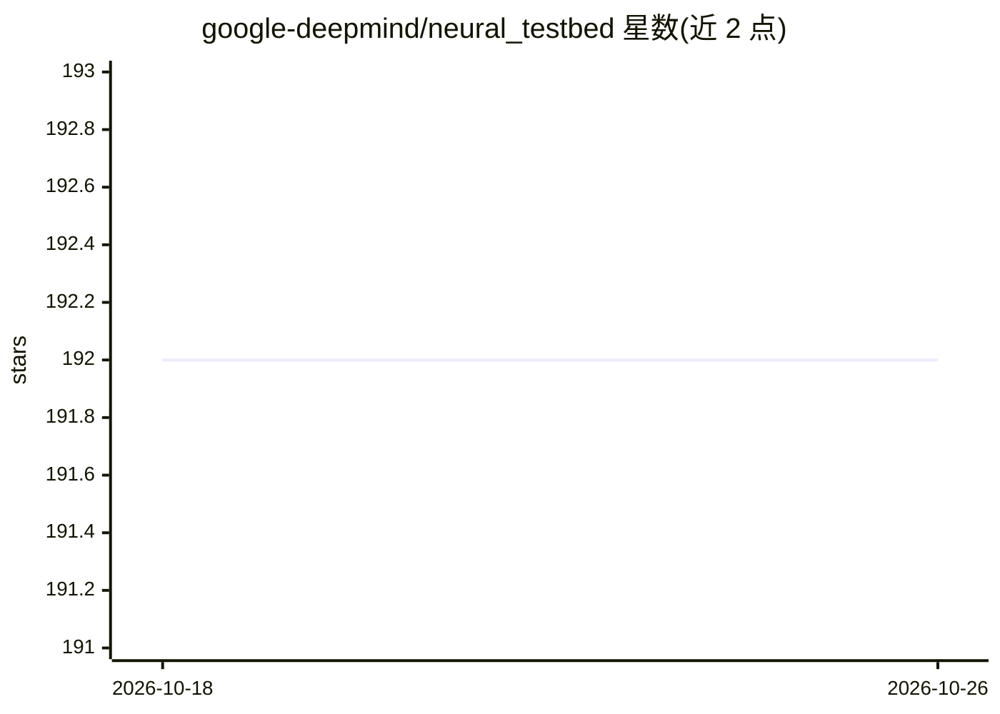

# google-deepmind/neural_testbed

⭐ 192 · Jupyter Notebook · Apache-2.0 · 推送 2026-10-05 · [GitHub](https://github.com/google-deepmind/neural_testbed) · 组织维护

**评估不确定性量化智能体的合成测试台库**

DeepMind 的 neural_testbed 是一个评测库：通过基于神经网络的合成生成模型，系统评估生成后验预测分布的学习智能体（agents），既评每输入的边缘预测质量，也评多输入的联合预测。核心接口为 TestbedAgent/TestbedProblem/EpistemicSampler，实验自动完成评测与日志输出，便于跨框架比较。附带基准智能体实现与超参数扫描，支持 colab 教程与本地 pip 安装（测试于 Python 3.7）。

## 筛选速览

| 维度 | 判定 | 备注 |
|---|---|---|
| AI 角色 | `ai-ecosystem` | LLM/agent 周边工具 |
| 许可风险 | `permissive` | Apache-2.0 |
| 部署形态 | `library` | 以包/库形式分发 |
| 模型依赖 | — | README 未给出锁定关系 |
| 硬件要求 | — | 无带数字的原话,不猜 |
| 安装摩擦 | `low` | 无编译、无系统依赖或容器化 |
| 成熟度 | — | 结构信号不足 |

## 能力要点

- 合成神经网络生成模型驱动的评测环境
- 评估联合预测分布而非仅边缘分布
- 提供基准智能体实现与超参数扫描
- 自动格式化输出结果，便于跨代码库比较

## 适用场景

- 评估自己的贝叶斯深度学习算法的不确定性量化质量
- 复现论文基准结果并作为新研究起点
- 跨框架比较不同智能体的联合预测表现

## 场景标签

`模型评测` · 领域:评测与运维

## 证据(README 行号)

> L8: The `neural_testbed` provides tools for the systematic evaluation of agents that generate such predictions.
> L12: This library automates the evaluation and analysis of learning agents:

## 星数曲线

2026-10-18 192 → 2026-10-26 192（+0）

---
*卡片 v1 · prompt 1.4 · 生成 2026-10-22 · 置信度 high · 依据 README sha `b82ee3a56b0f` · [字段定义](../../DATASET.md)*
