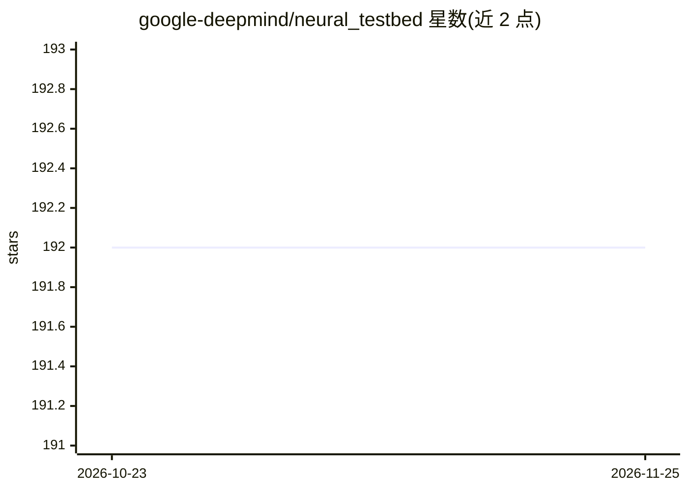

# google-deepmind/neural_testbed

⭐ 192 · Jupyter Notebook · Apache-2.0 · 推送 2026-11-10 · [GitHub](https://github.com/google-deepmind/neural_testbed) · 组织维护

**评估贝叶斯深度学习 agent 联合预测质量的测试库**

DeepMind 发布的 Python 库，用于系统性评估生成后验预测分布的学习 agent：通过基于神经网络的合成生成模型构造任务，评估 agent 的边际预测与多输入联合预测质量，并提供带完整超参数扫描的基准 agent 实现供复现论文结果。核心接口包括 EpistemicSampler、TestbedAgent、TestbedProblem；用户实现 TestbedAgent 后即可在 testbed 上运行评估，结果自动输出为 csv，便于跨代码库比较。支持 Colab 在线教程或本地 pip 安装，论文测试于 Python 3.7。

## 筛选速览

| 维度 | 判定 | 备注 |
|---|---|---|
| AI 角色 | `ai-native` | 本体是模型或模型工具 |
| 许可风险 | `permissive` | Apache-2.0 |
| 部署形态 | `library` | 以包/库形式分发 |
| 模型依赖 | — | README 未给出锁定关系 |
| 硬件要求 | — | 无带数字的原话,不猜 |
| 安装摩擦 | `low` | 无编译、无系统依赖或容器化 |
| 成熟度 | — | 结构信号不足 |

## 能力要点

- 评估边际预测之外的联合预测分布质量
- 自动化评估与日志输出，支持跨框架比较结果
- 附带基准 agent 与完整超参数扫描配置
- 提供 Colab 教程与 csv 结果输出

## 适用场景

- 为新的贝叶斯深度学习方法做联合预测质量基准评估
- 复现论文中的基准 agent 结果
- 在合成任务上比较不同不确定性量化方法

## 场景标签

`模型评测` · 领域:评测与运维

## 证据(README 行号)

> L8: estimates. The `neural_testbed` provides tools for the systematic evaluation of
> L15: This library automates the evaluation and analysis of learning agents:

## 星数曲线

2026-10-23 192 → 2026-11-25 192（+0）

---
*卡片 v1 · prompt 1.4 · 生成 2026-11-25 · 置信度 high · 依据 README sha `1163c3bbec62` · [字段定义](../../DATASET.md)*
