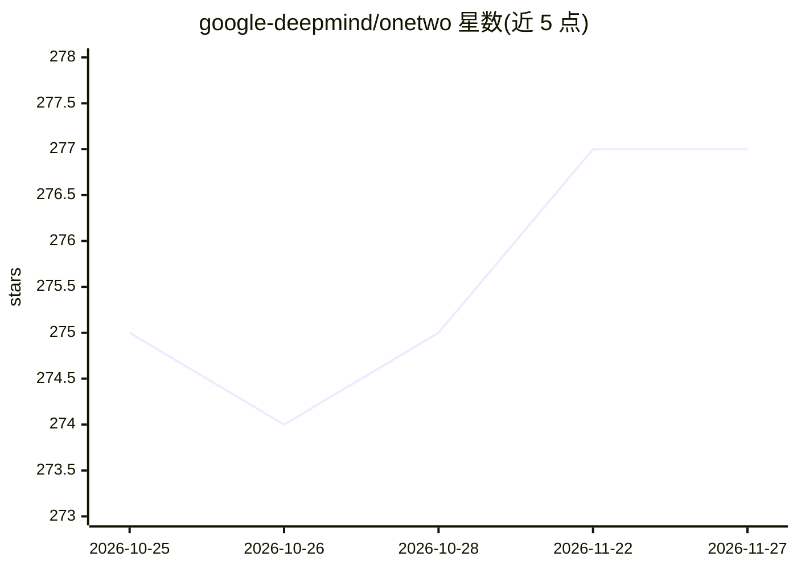

# google-deepmind/onetwo

⭐ 277 · Python · Apache-2.0 · 推送 2026-11-20 · [GitHub](https://github.com/google-deepmind/onetwo) · 组织维护

**开发与部署 LLM agent 和 RAG 工作流的 Python 库**

面向生产环境构建 LLM agent 与 RAG 流程的 Python 库：提供两步函数调用完成索引构建与问答评估的 RAG 框架，支持从语料构建向量索引或 GraphRAG 知识图谱索引，索引可经 MCP server 提供服务；支持统一 API 的模型无关调用、多种提示词写法、结果缓存复现实验、在沙箱中运行模型生成的 Python 代码，以及有状态 agent 的定义与组合，异步执行、批处理与缓存由库自动处理。要求 Python 3.13+，从 GitHub 源码 pip 安装。

## 筛选速览

| 维度 | 判定 | 备注 |
|---|---|---|
| AI 角色 | `ai-ecosystem` | LLM/agent 周边工具 |
| 许可风险 | `permissive` | Apache-2.0 |
| 部署形态 | `library` | 以包/库形式分发 |
| 模型依赖 | — | README 未给出锁定关系 |
| 硬件要求 | — | 无带数字的原话,不猜 |
| 安装摩擦 | `low` | 无编译、无系统依赖或容器化 |
| 成熟度 | — | 结构信号不足 |

## 能力要点

- 两步函数调用（rag.build_index / rag.evaluate）完成 RAG 索引构建与评估
- 支持 GraphRAG 知识图谱索引与 agentic retrieval 策略，索引可作为 MCP server 提供
- 统一 API 实现模型无关，切换模型不需修改逻辑
- 自动结果缓存以重放实验，自动处理异步执行与请求批处理

## 适用场景

- 在自有文档语料上搭建并评估 RAG 问答流程
- 构建可在生产中组合调用的有状态 LLM agent
- 复现 BrowseComp-Plus 等基准上的 QA 策略对比实验

## 场景标签

`RAG` `Agent 框架` · 领域:Agent 开发

## 证据(README 行号)

> L5:  One Two is a Python library for developing and deploying LLM
> L6: agents and RAG workflows in production. In just a few lines of code, you can
> L13: * **Build end-to-end RAG pipelines (Retrieval-Augmented Generation)**: Build
> L120: OneTwo makes it really easy to build stateful, autonomous agents that can

## 星数曲线

2026-10-25 275 → 2026-11-27 277（+2）

---
*卡片 v1 · prompt 1.4 · 生成 2026-11-25 · 置信度 high · 依据 README sha `c3880ea27c48` · [字段定义](../../DATASET.md)*
