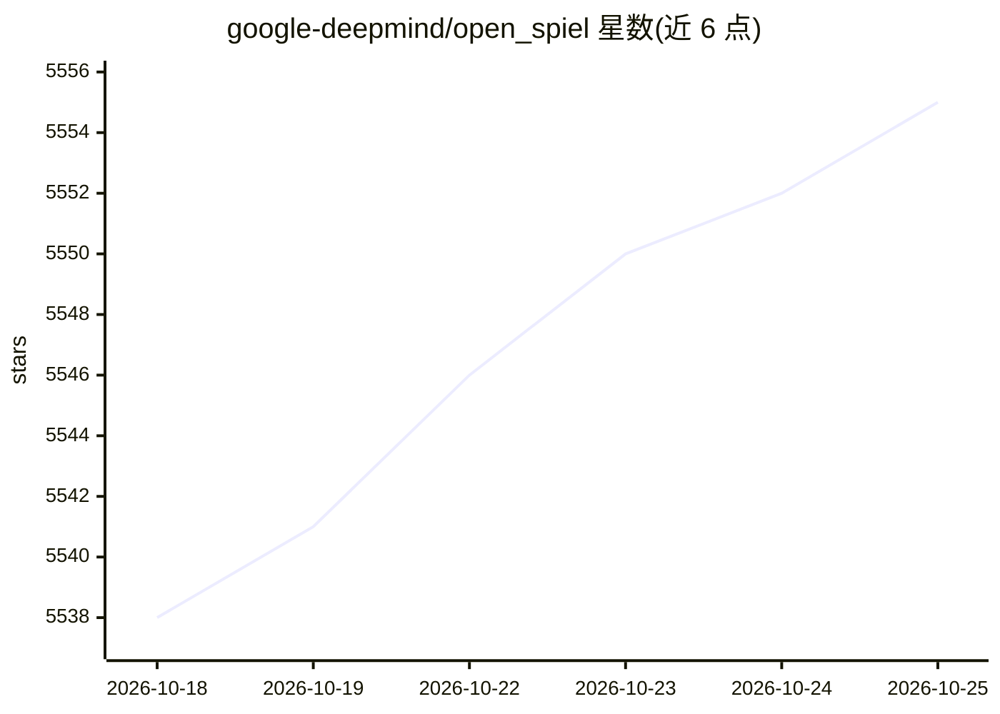

# google-deepmind/open_spiel

⭐ 5,555 · C++ · Apache-2.0 · 推送 2026-10-24 · [GitHub](https://github.com/google-deepmind/open_spiel) · 组织维护

**面向博弈中强化学习与搜索规划研究的环境与算法框架**

提供博弈环境集合与算法集合，用于一般强化学习及搜索/规划研究：支持 n 玩家（单/多智能体）零和、合作、一般和、一次性与序贯、轮流与同时行动、完美与不完美信息博弈，以及网格世界与社会困境等多智能体环境；附带学习动力学分析工具与常用评估指标。核心 API 与博弈以 C++ 实现并暴露给 Python，算法与工具兼用 C++ 与 Python 编写。支持 Linux/macOS 安装，Windows 另有说明；提供 Colab 入口与配套论文。

## 筛选速览

| 维度 | 判定 | 备注 |
|---|---|---|
| AI 角色 | `ai-ecosystem` | LLM/agent 周边工具 |
| 许可风险 | `permissive` | Apache-2.0 |
| 部署形态 | `None` |  |
| 模型依赖 | — | README 未给出锁定关系 |
| 硬件要求 | — | 无带数字的原话,不猜 |
| 安装摩擦 | `low` | 无编译、无系统依赖或容器化 |
| 成熟度 | — | 结构信号不足 |

## 能力要点

- 覆盖零和/合作/一般和、完美/不完美信息等多类博弈环境
- 核心 API 与博弈以 C++ 实现并暴露给 Python
- 包含学习动力学分析工具与常用评估指标
- 提供 Colab 教程与配套论文（Lanctot et al. 2019）

## 适用场景

- 在多种博弈环境中做强化学习实验与算法对比
- 研究多智能体、不完美信息博弈中的搜索与规划
- 分析学习动力学并做标准化评估

## 场景标签

`强化学习` `多智能体` · 领域:Agent 开发

## 证据(README 行号)

> L7: OpenSpiel is a collection of environments and algorithms for research in general
> L8: reinforcement learning and search/planning in games. OpenSpiel supports n-player
> L15: natural extensions. The core API and games are implemented in C++ and exposed to

## 星数曲线

2026-10-18 5,538 → 2026-10-25 5,555（+17）

---
*卡片 v1 · prompt 1.4 · 生成 2026-10-20 · 置信度 high · 依据 README sha `ccefde66b3ed` · [字段定义](../../DATASET.md)*
