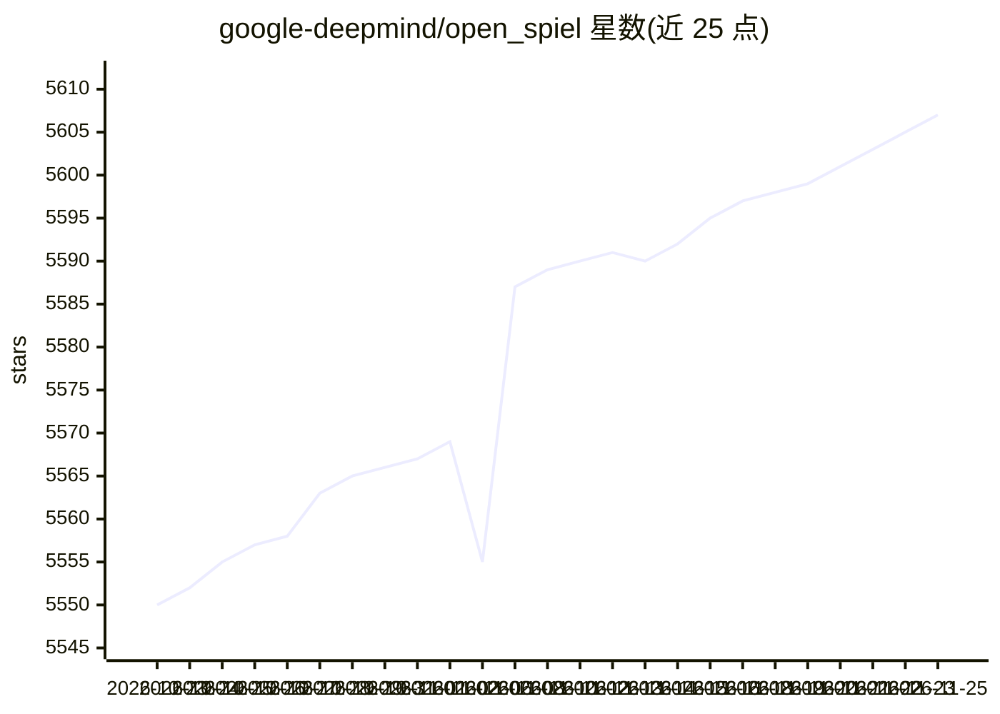

# google-deepmind/open_spiel

⭐ 5,607 · Python · Apache-2.0 · 推送 2026-11-14 · [GitHub](https://github.com/google-deepmind/open_spiel) · 组织维护

**游戏强化学习与搜索规划研究的环境与算法集合**

面向通用强化学习与游戏中搜索/规划研究的开源框架：提供 n 人零和/合作/一般和、一次性与序贯、同时行动等博弈环境，以及网格世界、社会困境等多智能体环境；核心 API 与游戏以 C++ 实现并暴露给 Python，算法与工具兼有 C++ 与 Python 版本，附学习动力学分析与常见评估指标工具。支持 Linux/macOS 安装（Windows 另有说明），提供 Colab 教程与预训练检查点数据。

## 筛选速览

| 维度 | 判定 | 备注 |
|---|---|---|
| AI 角色 | `ai-native` | 本体是模型或模型工具 |
| 许可风险 | `permissive` | Apache-2.0 |
| 部署形态 | `None` |  |
| 模型依赖 | — | README 未给出锁定关系 |
| 硬件要求 | — | 无带数字的原话,不猜 |
| 安装摩擦 | `low` | 无编译、无系统依赖或容器化 |
| 成熟度 | — | 结构信号不足 |

## 能力要点

- C++ 核心 API 与游戏实现，暴露给 Python 使用
- 支持单/多智能体、完美与不完美信息等多种博弈类型
- 提供学习动力学分析与评估指标工具
- 发布预训练基线检查点与参考游戏数据集

## 适用场景

- 研究中实现和比较强化学习与搜索规划算法
- 在标准博弈环境中做多智能体实验
- 通过 Colab 教程上手核心 API

## 场景标签

`强化学习` `多智能体` `科研工具` · 领域:Agent 开发

## 证据(README 行号)

> L7: OpenSpiel is a collection of environments and algorithms for research in general
> L15: natural extensions. The core API and games are implemented in C++ and exposed to

## 星数曲线

2026-10-23 5,550 → 2026-11-25 5,607（+57）

---
*卡片 v1 · prompt 1.4 · 生成 2026-11-22 · 置信度 high · 依据 README sha `c9a4c1a88bb8` · [字段定义](../../DATASET.md)*
