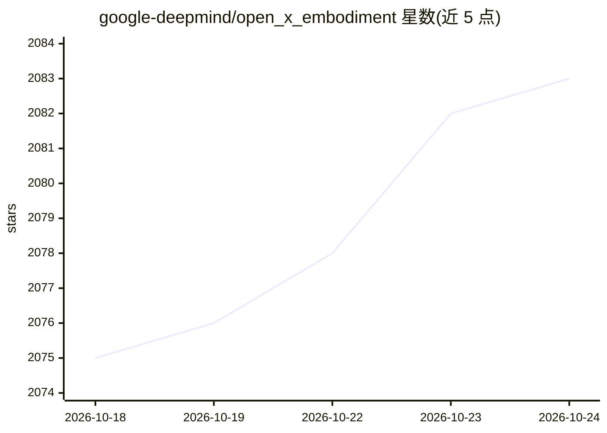

# google-deepmind/open_x_embodiment

⭐ 2,083 · Jupyter Notebook · Apache-2.0 · 推送 2025-11-05 · [GitHub](https://github.com/google-deepmind/open_x_embodiment) · 组织维护

**机器人操作数据集统一格式集合与 RT-1-X 模型检查点发布**

由 Google DeepMind 维护的仓库：将各开源机器人数据集以统一的 RLDS episode 格式汇集，提供数据集清单与元数据表格、可视化与构造训练批次的 colab；同时发布 RT-1-X 机器人操作模型检查点（TensorFlow/JAX），模型输入工作区相机 RGB 图像与任务字符串，输出含夹爪七维动作。附带推理 colab 演示加载检查点并在离线 episodes 上做推理。面向机器人学习研究者与开发者。

## 筛选速览

| 维度 | 判定 | 备注 |
|---|---|---|
| AI 角色 | `ai-knowledge` | 知识聚合/清单类 |
| 许可风险 | `permissive` | Apache-2.0 |
| 部署形态 | `None` |  |
| 模型依赖 | — | README 未给出锁定关系 |
| 硬件要求 | — | 无带数字的原话,不猜 |
| 安装摩擦 | `low` | 无编译、无系统依赖或容器化 |
| 成熟度 | — | 结构信号不足 |

## 能力要点

- 多来源机器人数据集统一为 RLDS episode 格式
- 提供可视化与构造训练/推理批次的自包含 colab
- RT-1-X 模型 TensorFlow/JAX 检查点及离线推理 colab

## 适用场景

- 获取统一格式的机器人操作数据用于模型训练
- 加载 RT-1-X 检查点做机器人动作推理实验
- 查阅各机器人数据集清单与元数据

## 场景标签

 · 领域:机器人/机器学习数据集

## 证据(README 行号)

> L3: Open X-Embodiment aims to provide all open-sourced robotic data in the same unified format, for easy downstream cons
> L21: ## RT-1-X Model checkpoint

## 星数曲线

2026-10-18 2,075 → 2026-10-24 2,083（+8）

---
*卡片 v1 · prompt 1.4 · 生成 2026-10-21 · 置信度 high · 依据 README sha `161d5d0e4907` · [字段定义](../../DATASET.md)*
