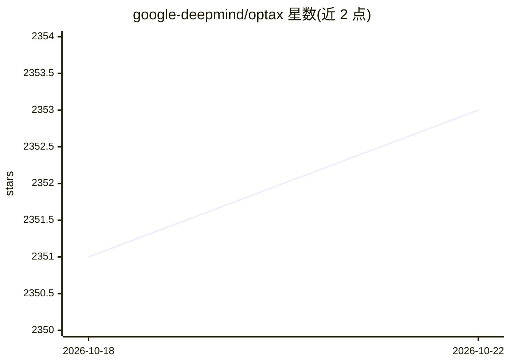

# google-deepmind/optax

⭐ 2,354 · Python · Apache-2.0 · 推送 2026-10-22 · [GitHub](https://github.com/google-deepmind/optax) · [官网](https://optax.readthedocs.io) · 组织维护

**面向 JAX 的梯度处理与优化器构建库**

DeepMind JAX Ecosystem 中的梯度处理与优化库，提供 Adam 等常用优化器、损失函数（如 l2_loss）及梯度变换组件的小型可组合积木，用户可重组这些底层组件构造自定义优化器；实现优先保证可读性与公式对应而非代码复用。前身为 JAX experimental 目录下的 jax.experimental.optix，后独立开源并更名。面向使用 JAX 做研究与训练的开发者，通过 PyPI 或 GitHub 源码安装，附测试脚本与文档构建流程。

## 筛选速览

| 维度 | 判定 | 备注 |
|---|---|---|
| AI 角色 | `ai-ecosystem` | LLM/agent 周边工具 |
| 许可风险 | `permissive` | Apache-2.0 |
| 部署形态 | `library` | 以包/库形式分发 |
| 模型依赖 | — | README 未给出锁定关系 |
| 硬件要求 | — | 无带数字的原话,不猜 |
| 安装摩擦 | `low` | 无编译、无系统依赖或容器化 |
| 成熟度 | — | 结构信号不足 |

## 能力要点

- 提供常用优化器（如 optax.adam）与损失函数实现
- 小型可组合积木，可重组为自定义优化器
- 前身 jax.experimental.optix 独立开源而来

## 适用场景

- 在 JAX 训练循环中做参数更新与梯度处理
- 组合底层梯度变换组件构造自定义优化器
- 研究与实验中替换或扩展优化算法

## 场景标签

 · 领域:机器学习/优化

## 证据(README 行号)

> L9: Optax is a gradient processing and optimization library for JAX.
> L11: Optax is designed to facilitate research by providing building blocks

## 星数曲线

2026-10-18 2,351 → 2026-10-22 2,353（+2）

---
*卡片 v1 · prompt 1.4 · 生成 2026-10-21 · 置信度 high · 依据 README sha `544e296355fb` · [字段定义](../../DATASET.md)*
