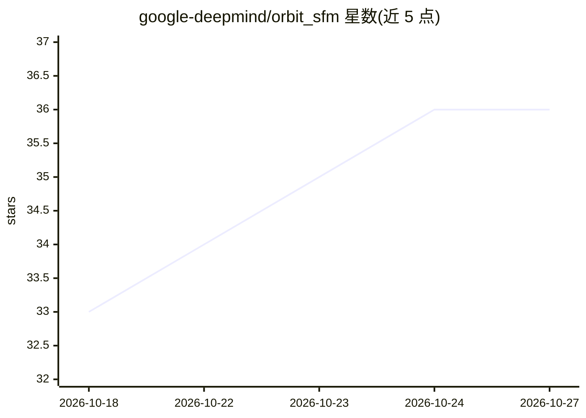

# google-deepmind/orbit_sfm

⭐ 36 · Jupyter Notebook · Apache-2.0 · 推送 2026-08-27 · [GitHub](https://github.com/google-deepmind/orbit_sfm) · 组织维护

**基于 360° 视频的 SfM 重建管线评测基准（ORBIT）**

DeepMind 发布的运动恢复结构（SfM）评测基准：提供从预处理的全景（等距柱状）图像投影生成基准片段的 notebook（create_orbit.ipynb），以及将 SfM 方法重建的相机轨迹与真值对比的评测 notebook（orbit_eval.ipynb），计算 ATE/RPE 指标并输出轨迹对比图与成功率曲线。附带片段清单、真值轨迹与相机内参/外旋文件。以 conda 环境 + Jupyter notebook 形式提供，示例在 COLMAP 3.9 上测试。

## 筛选速览

| 维度 | 判定 | 备注 |
|---|---|---|
| AI 角色 | `ai-ecosystem` | LLM/agent 周边工具 |
| 许可风险 | `permissive` | Apache-2.0 |
| 部署形态 | `library` | 以包/库形式分发 |
| 模型依赖 | — | README 未给出锁定关系 |
| 硬件要求 | — | 无带数字的原话,不猜 |
| 安装摩擦 | `medium` | 含编译或系统依赖之一 |
| 成熟度 | — | 结构信号不足 |

## 能力要点

- 全景图像投影生成带真值轨迹的基准片段
- ATE/RPE 指标评测 SfM 重建的相机轨迹
- 输出逐片段轨迹对比图、汇总表与成功率曲线
- 提供 COLMAP 运行示例（在 3.9 版本测试）

## 适用场景

- 为自己的 SfM 管线提供带真值的定量评测
- 生成受控视角的基准图像片段
- 对比多个 SfM 方法的轨迹精度

## 场景标签

`模型评测` · 领域:评测与运维

## 证据(README 行号)

> L1: # ORBIT: A 360 Based Benchmark for evaluating SFM pipelines
> L24: - **`orbit_eval.ipynb`**: Notebook for evaluating SfM methods against the
> L78: The notebook computes ATE (Absolute Trajectory Error) and RPE (Relative Pose

## 星数曲线

2026-10-18 33 → 2026-10-27 36（+3）

---
*卡片 v1 · prompt 1.4 · 生成 2026-10-25 · 置信度 mid · 依据 README sha `8397a3145057` · [字段定义](../../DATASET.md)*
