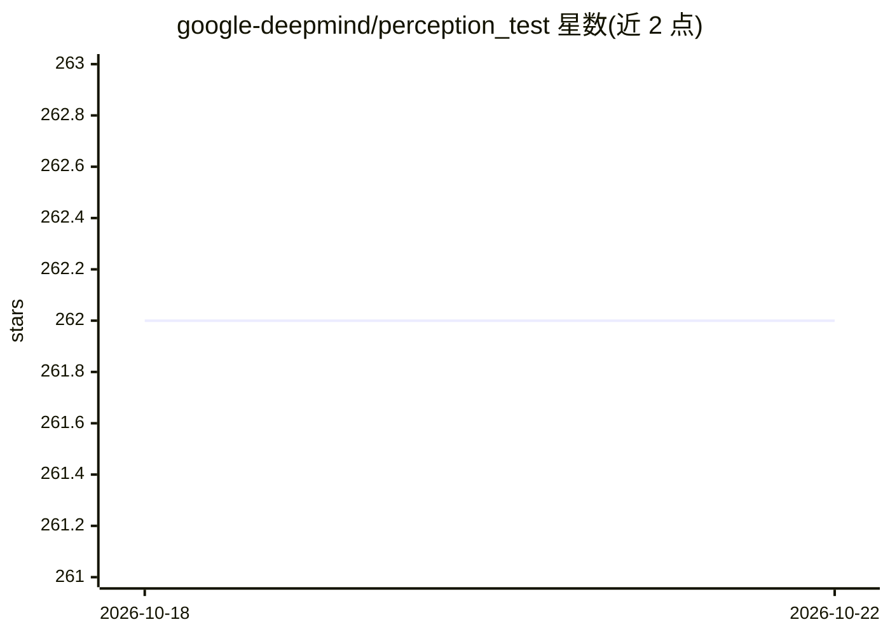

# google-deepmind/perception_test

⭐ 262 · Jupyter Notebook · Apache-2.0 · 推送 2026-06-19 · [GitHub](https://github.com/google-deepmind/perception_test) · 组织维护

**多模态视频模型感知能力的诊断评测基准数据集**

DeepMind 维护的 Perception Test 基准仓库：提供真实世界视频数据集（含音频、JSON 标注及预计算特征），覆盖六项任务——多选视频问答、定位视频问答、目标跟踪、点跟踪、时序动作定位与声音定位。数据以 zip 分卷下载（完整训练集约 26.5GB 视频），附各任务 dummy 基线（Static、ActionFormer、MDETR 等）、评测指标定义与 Colab 可视化/探索笔记本；标注含 18 万余条目标轨迹与 3.8 万余道多选题，指标评测代码标注为 coming soon。

## 筛选速览

| 维度 | 判定 | 备注 |
|---|---|---|
| AI 角色 | `ai-knowledge` | 知识聚合/清单类 |
| 许可风险 | `permissive` | Apache-2.0 |
| 部署形态 | `desktop` | 安装包/桌面程序 |
| 模型依赖 | — | README 未给出锁定关系 |
| 硬件要求 | — | 无带数字的原话,不猜 |
| 安装摩擦 | `low` | 无编译、无系统依赖或容器化 |
| 成熟度 | — | 结构信号不足 |

## 能力要点

- 六项任务覆盖视觉、音频、文本三种模态
- 完整数据集含 11,609 条目标轨迹、38,060 道多选题等标注
- 提供各任务 dummy 基线与指标定义
- 配套 ECCV2026 第四届挑战赛与评测服务器

## 适用场景

- 评测多模态视频模型的感知与推理能力
- 在六项感知任务上复现或对比基线结果
- 参加 Perception Test 挑战赛并提交结果

## 场景标签

 · 领域:多模态视频模型评测

## 证据(README 行号)

> L15: Perception Test: A Diagnostic Benchmark for Multimodal Video Models is a multimodal benchmark designed to comprehen
> L17: In this repository, you will find:

## 星数曲线

2026-10-18 262 → 2026-10-22 262（+0）

---
*卡片 v1 · prompt 1.4 · 生成 2026-10-22 · 置信度 high · 依据 README sha `6bab53a3ab25` · [字段定义](../../DATASET.md)*
