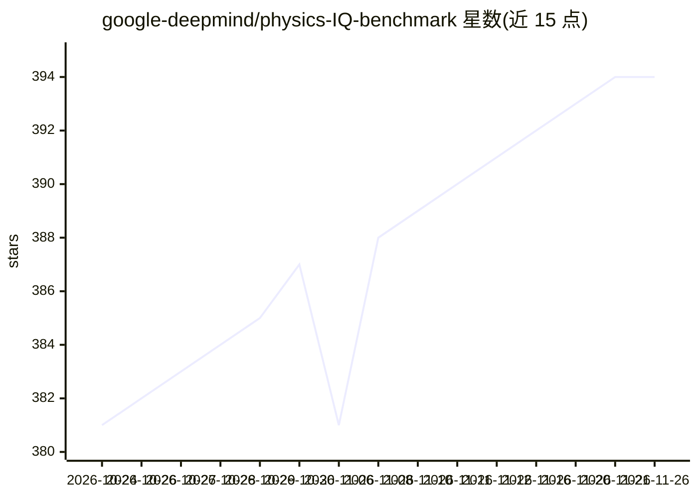

# google-deepmind/physics-IQ-benchmark

⭐ 394 · Python · NOASSERTION · 推送 2026-11-18 · [GitHub](https://github.com/google-deepmind/physics-IQ-benchmark) · [官网](https://physics-iq.github.io/) · 组织维护

**评测生成式视频模型物理理解能力的数据集与评测流程**

Physics-IQ 是用于评测生成式视频模型物理理解能力的基准数据集，包含碰撞、流体、重力、材料属性、光影、磁性等物理现象的实拍视频（4K 分辨率、30fps、每场景 3 个机位、录制两次）。仓库提供 Physics-IQ Verified 与 Original 两个评测流程，含改进的 prompt、掩码与评分方式；README 维护两个模型的排行榜，并通过 Hugging Face 数据集分发测试数据，访问申请自动批准。

## 筛选速览

| 维度 | 判定 | 备注 |
|---|---|---|
| AI 角色 | `ai-knowledge` | 知识聚合/清单类 |
| 许可风险 | `none` | NOASSERTION |
| 部署形态 | `library` | 以包/库形式分发 |
| 模型依赖 | — | README 未给出锁定关系 |
| 硬件要求 | — | 无带数字的原话,不猜 |
| 安装摩擦 | `medium` | 含编译或系统依赖之一 |
| 成熟度 | — | 结构信号不足 |

## 能力要点

- 实拍（非渲染）视频数据集，3840×2160@30fps，每场景 3 个机位
- 覆盖碰撞、流体、重力、材料、光影、磁性等多种物理现象
- 提供 Verified 与 Original 两套评测流程及对应排行榜
- 测试数据经 Hugging Face 数据集分发，访问申请自动批准

## 适用场景

- 在提交视频生成模型前评测其物理理解得分
- 在 Physics-IQ Verified 排行榜上收录自己的模型成绩
- 研究多角度实拍场景下视频生成与物理一致性评测

## 场景标签

`模型评测` `视频生成` · 领域:评测与运维

## 证据(README 行号)

> L7: Physics-IQ is a high-quality, realistic, and comprehensive benchmark dataset for evaluating physical understanding i
> L10: This repository contains the workflow for both Physics-IQ Verified (recommended benchmark variant) and the original
> L147: - **Physics-IQ Verified Workflow**: recommended benchmark with improved prompts, masks, and scoring. This is the d

## 星数曲线

2026-10-24 381 → 2026-11-26 394（+13）

---
*卡片 v1 · prompt 1.4 · 生成 2026-11-25 · 置信度 mid · 依据 README sha `d386103c7867` · [字段定义](../../DATASET.md)*
