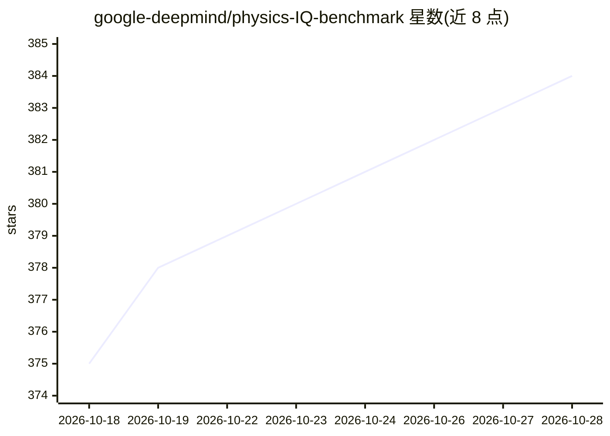

# google-deepmind/physics-IQ-benchmark

⭐ 384 · Python · NOASSERTION · 推送 2026-10-20 · [GitHub](https://github.com/google-deepmind/physics-IQ-benchmark) · [官网](https://physics-iq.github.io/) · 组织维护

**评测生成式视频模型物理理解能力的基准数据集与工作流**

Google DeepMind 维护的物理理解评测基准：Physics-IQ 数据集包含真实拍摄（非渲染）的高分辨率视频场景，覆盖碰撞、流体、重力、磁性等物理现象，每场景 3 个机位、两次录制；Physics-IQ Verified 为改进提示词、遮罩与评分的推荐变体。仓库提供两者评测工作流，含在线排行榜（接受 PR 提交成绩）与 Hugging Face 数据集下载入口，测试数据禁止用于优化成绩。

## 筛选速览

| 维度 | 判定 | 备注 |
|---|---|---|
| AI 角色 | `ai-ecosystem` | LLM/agent 周边工具 |
| 许可风险 | `none` | NOASSERTION |
| 部署形态 | `library` | 以包/库形式分发 |
| 模型依赖 | — | README 未给出锁定关系 |
| 硬件要求 | — | 无带数字的原话,不猜 |
| 安装摩擦 | `medium` | 含编译或系统依赖之一 |
| 成熟度 | — | 结构信号不足 |

## 能力要点

- 真实拍摄视频（3840×2160、30fps），每场景 3 机位、2 次录制
- 覆盖碰撞、流体、重力、材料、光影、磁性等物理现象
- 含 Physics-IQ Verified 改进版工作流与原始版工作流（--original_physics_iq）
- 在线排行榜接受 PR 提交，要求可复现的方法文档

## 适用场景

- 评测视频生成模型的物理一致性得分
- 对比不同视频生成模型在物理理解上的表现
- 按 Verified 工作流复现或提交模型成绩

## 场景标签

`模型评测` · 领域:评测与运维

## 证据(README 行号)

> L7: Physics-IQ is a high-quality, realistic, and comprehensive benchmark dataset for evaluating physical understanding i
> L10: This repository contains the workflow for both Physics-IQ Verified (recommended benchmark variant) and the original
> L147: - **Physics-IQ Verified Workflow**: recommended benchmark with improved prompts, masks, and scoring. This is the d

## 星数曲线

2026-10-18 375 → 2026-10-28 384（+9）

---
*卡片 v1 · prompt 1.4 · 生成 2026-10-21 · 置信度 mid · 依据 README sha `166d7a0a2d0f` · [字段定义](../../DATASET.md)*
