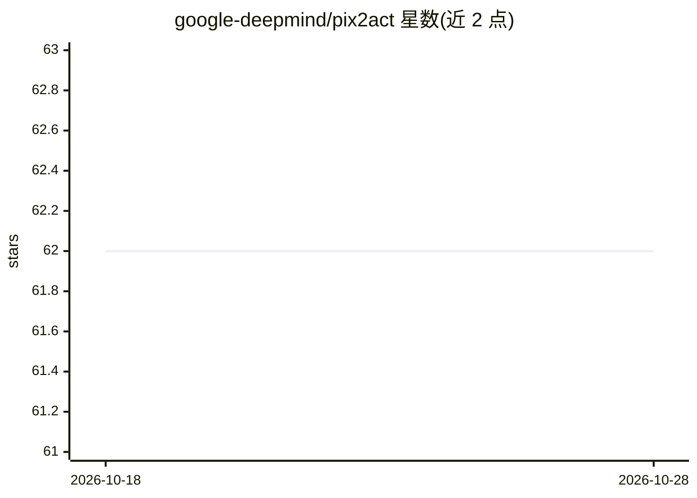

# google-deepmind/pix2act

⭐ 62 · Python · Apache-2.0 · 推送 2026-09-09 · [GitHub](https://github.com/google-deepmind/pix2act) · 组织维护

**GUI 指令跟随模型代码：从像素截图生成界面操作**

NeurIPS 2023 论文 From Pixels to UI Actions 的官方代码库。基于 Pix2Struct 视觉-文本模型，在 MiniWoB 与 WebShop 环境上执行 GUI 指令跟随任务：模型读取界面截图，输出 UI 操作。提供 gRPC 模型服务器做推理，发布 MiniWoB/WebShop 微调检查点（Google Cloud 托管），支持用 MCTS 生成训练数据，训练基于 T5X 封装、可在 TPU 上运行。推理评测依赖 Chrome/ChromeDriver、miniwob-plusplus 与 protobuffer 代码生成，面向复现论文实验的研究者。

## 筛选速览

| 维度 | 判定 | 备注 |
|---|---|---|
| AI 角色 | `ai-native` | 本体是模型或模型工具 |
| 许可风险 | `permissive` | Apache-2.0 |
| 部署形态 | `library` | 以包/库形式分发 |
| 模型依赖 | — | README 未给出锁定关系 |
| 硬件要求 | — | 无带数字的原话,不猜 |
| 安装摩擦 | `low` | 无编译、无系统依赖或容器化 |
| 成熟度 | — | 结构信号不足 |

## 能力要点

- 基于 Pix2Struct 的截图→UI 操作生成
- 提供 MiniWoB 与 WebShop 微调检查点（GCS 托管）
- gRPC 模型服务器推理，支持 TPU 与多服务器负载均衡
- MCTS 训练数据生成与 T5X 训练流程

## 适用场景

- 复现论文中 MiniWoB/WebShop 的指令跟随评测
- 基于检查点对截图做 UI 操作预测推理
- 用 MCTS 生成新的训练数据并微调模型

## 场景标签

`GUI 自动化` `微调` · 领域:效率与自动化

## 证据(README 行号)

> L3: This repository contains code for our NeurIPS 2023 paper From Pixels to UI Actions: Learning to Follow Instructions 
> L101: You can start a model server for generating predictions for MiniWob via the following

## 星数曲线

2026-10-18 62 → 2026-10-28 62（+0）

---
*卡片 v1 · prompt 1.4 · 生成 2026-10-24 · 置信度 high · 依据 README sha `27eb6e5d8f9c` · [字段定义](../../DATASET.md)*
