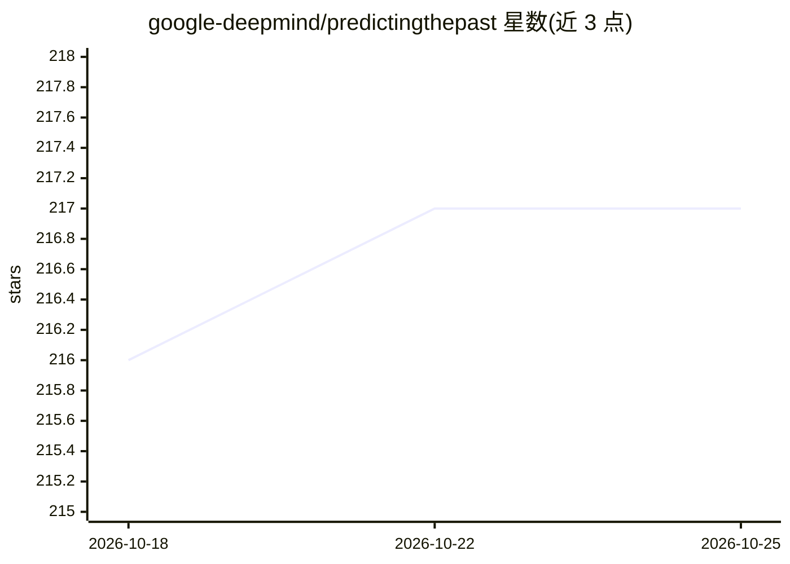

# google-deepmind/predictingthepast

⭐ 217 · Python · Apache-2.0 · 推送 2026-10-21 · [GitHub](https://github.com/google-deepmind/predictingthepast) · 组织维护

**古文本修复与断代归因的生成神经网络（Aeneas）**

Google DeepMind 等机构发布的 Aeneas 模型官方代码库：面向拉丁文与古希腊文铭文，基于 transformer 解码器躯干与多个专用头部，完成缺损文本修复、地理与年代归因，并利用历史增强嵌入从 LED/I.PHI 数据集中检索相似铭文。提供 pip 安装的 predictingthepast 库、在线 Colab 交互界面与离线推理脚本（需另行下载模型权重文件），训练数据来自 EDR/EDH/EDCS_ETL 与 I.PHI 数据集，训练说明见 train/README.md。

## 筛选速览

| 维度 | 判定 | 备注 |
|---|---|---|
| AI 角色 | `ai-native` | 本体是模型或模型工具 |
| 许可风险 | `permissive` | Apache-2.0 |
| 部署形态 | `library` | 以包/库形式分发 |
| 模型依赖 | — | README 未给出锁定关系 |
| 硬件要求 | — | 无带数字的原话,不猜 |
| 安装摩擦 | `low` | 无编译、无系统依赖或容器化 |
| 成熟度 | — | 结构信号不足 |

## 能力要点

- 任意长度缺损文本修复、年代与地理归因多头输出
- 基于历史增强嵌入检索相似铭文作为平行文本
- 提供拉丁文与古希腊文两个已训练模型及下载命令
- 在线 Colab 交互界面可查询修复结果并可视化注意力权重

## 适用场景

- 历史研究者修复受损铭文文本
- 为铭文做年代与地理归属推断
- 检索相似铭文以辅助历史文本语境化研究

## 场景标签

`科研工具` · 领域:学习与行业

## 证据(README 行号)

> L39: historical scopes. We introduce Aeneas, the first generative neural network for
> L63: transformer-based decoder, the "torso", to process the text. Specialised
> L64: networks, called "heads", handle character restoration, date attribution, and

## 星数曲线

2026-10-18 216 → 2026-10-25 217（+1）

---
*卡片 v1 · prompt 1.4 · 生成 2026-10-22 · 置信度 high · 依据 README sha `24edf242b7f6` · [字段定义](../../DATASET.md)*
