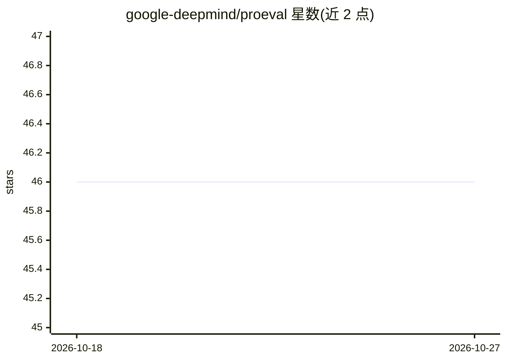

# google-deepmind/proeval

⭐ 46 · Python · Apache-2.0 · 推送 2026-09-28 · [GitHub](https://github.com/google-deepmind/proeval) · 组织维护

**GenAI 评测降本框架：更少样本估计模型性能并发现失败模式**

Python 库，面向生成式 AI 评测场景：用贝叶斯二次（BQ）采样与预训练 GP 代理模型，以少量样本估计模型准确率（±1%），并在评测预算内主动发现失败案例；支持推理、安全、分类等基准（GSM8K、MMLU、StrategyQA、Jigsaw 等）。提供 BQPriorSampler 等 API，可从内存中的预测表运行，无需 API key；支持接入外部评测 harness。Python 3.9+，PyPI 安装（可选 encoder/topics/datasets 扩展），论文复现数据约 381 MB 仅存于仓库。

## 筛选速览

| 维度 | 判定 | 备注 |
|---|---|---|
| AI 角色 | `ai-ecosystem` | LLM/agent 周边工具 |
| 许可风险 | `permissive` | Apache-2.0 |
| 部署形态 | `library` | 以包/库形式分发 |
| 模型依赖 | — | README 未给出锁定关系 |
| 硬件要求 | — | 无带数字的原话,不猜 |
| 安装摩擦 | `low` | 无编译、无系统依赖或容器化 |
| 成熟度 | — | 结构信号不足 |

## 能力要点

- BQ 采样在少量样本下估计模型准确率（±1%）
- 预训练 GP 代理模型可迁移到新模型
- 预算内主动发现多样化失败案例
- 快速入门示例无需 API key 与研究数据即可运行

## 适用场景

- 降低大规模 GenAI 评测的调用成本
- 在评测预算内主动发现模型失败模式
- 基于历史源模型分数规划评测样本并接入外部评测 harness

## 场景标签

`模型评测` · 领域:评测与运维

## 证据(README 行号)

> L9: Slash GenAI evaluation costs by up to 100x while actively discovering model failure patterns to guide better AI deve
> L11: 1. 💰 **Cut GenAI eval costs up to 100×** — achieve ±1% accuracy with a fraction of the samples
> L15: 5. ✅ **Validated on reasoning, safety & classification** — GSM8K, MMLU, StrategyQA, Jigsaw, and more

## 星数曲线

2026-10-18 46 → 2026-10-27 46（+0）

---
*卡片 v1 · prompt 1.4 · 生成 2026-10-25 · 置信度 high · 依据 README sha `f1a0b4afe370` · [字段定义](../../DATASET.md)*
