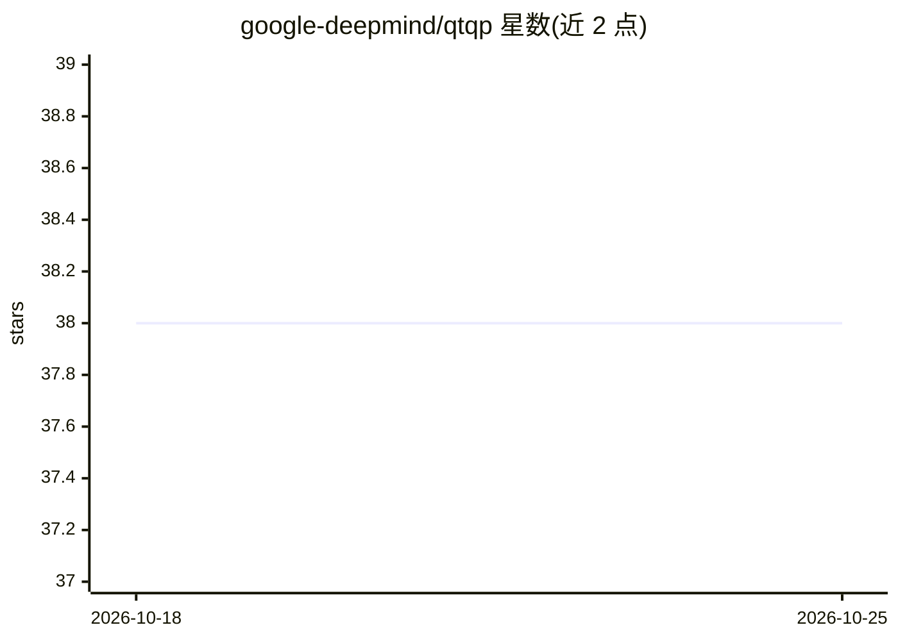

# google-deepmind/qtqp

⭐ 38 · Python · Apache-2.0 · 推送 2026-10-15 · [GitHub](https://github.com/google-deepmind/qtqp) · 组织维护

**纯 Python 实现的凸二次规划原始-对偶内点求解器**

Google DeepMind 维护的 QP 求解库：以原始-对偶内点法求解带等式与不等式约束的凸二次规划，存在解时返回原始-对偶解，否则返回原始或对偶不可行证书。支持多种可选线性求解后端（MKL Pardiso、QDLDL、CUDA 上 CUDSS/CUPY、CHOLMOD、UMFPACK、MUMPS、EIGEN 等），提供 Ruiz 平衡、GMRES 迭代精化、Gondzio 中心校正与经验性 warm start 筛选。通过 pip 安装，面向 Python 开发者。

## 筛选速览

| 维度 | 判定 | 备注 |
|---|---|---|
| AI 角色 | `ai-ecosystem` | LLM/agent 周边工具 |
| 许可风险 | `permissive` | Apache-2.0 |
| 部署形态 | `library` | 以包/库形式分发 |
| 模型依赖 | — | README 未给出锁定关系 |
| 硬件要求 | — | 无带数字的原话,不猜 |
| 安装摩擦 | `medium` | 含编译或系统依赖之一 |
| 成熟度 | — | 结构信号不足 |

## 能力要点

- 纯 Python 原始-对偶内点法，返回解或不可行性证书
- 多种可选 KKT 线性求解后端，含 CPU 稀疏与 CUDA GPU（cu12/cu13 extras）
- Clarabel 式初始化、GMRES/Richardson 迭代精化、Gondzio 中心校正
- warm start 经验筛选：四次候选打分后决定是否接受，无需额外分解

## 适用场景

- 在 Python 中求解带等式/不等式约束的凸二次规划
- 需要不可行性证书而非仅报错的优化流程
- 利用 GPU 后端加速大规模稀疏 QP 的 KKT 求解

## 场景标签

 · 领域:数值优化/科学计算

## 证据(README 行号)

> L5: The cutie QP solver is a primal-dual interior point method for solving
> L6: convex quadratic programs (QPs), implemented in pure python. It solves the

## 星数曲线

2026-10-18 38 → 2026-10-25 38（+0）

---
*卡片 v1 · prompt 1.4 · 生成 2026-10-25 · 置信度 low · 依据 README sha `e5a83b01ef80` · [字段定义](../../DATASET.md)*
